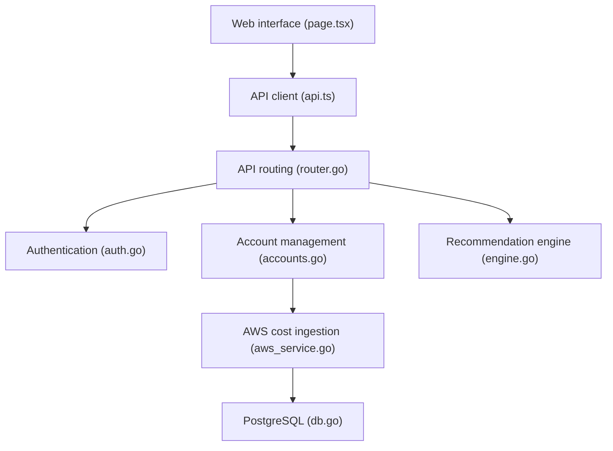

# oseghalep/cloud-cost-optimization-hub

> Web application for tracking AWS, GCP and Azure costs, in version 0.1 with fictitious data.

## The problem
Cloud bills arrive separately by provider, and cost drifts are discovered late. A single view of costs and savings opportunities is missing.

## What it actually does
A user signs up, logs in and sees a dashboard fed by **demo data**. The code contains AWS, GCP and Azure ingestion services and a recommendation engine, but the README only says "ready for real integration": real integration is not documented as done. Go backend (Gin), PostgreSQL + TimescaleDB, Redis, Next.js 14 frontend.

## How it is wired


## Trying it
```bash
git clone https://github.com/oseghalep/cloud-cost-optimization-hub.git
cd cloud-cost-optimization-hub
cp .env.example .env
make up
# puis http://localhost:3000, créer un compte sur /register
```

## Cost and gotchas
Free locally via Docker Compose (startup ~30 s). Real integration would require cloud credentials, not documented here.

## What it is not
Not an operational FinOps tool: the costs displayed are fictitious in v0.1. The "prod" Helm chart is mentioned but not detailed.

## Alternatives
No alternative named in the README.

## For you
Ignore: a 0.1 prototype on simulated data, unidentified license and a single maintainer; nothing to take from it for real cost tracking.
