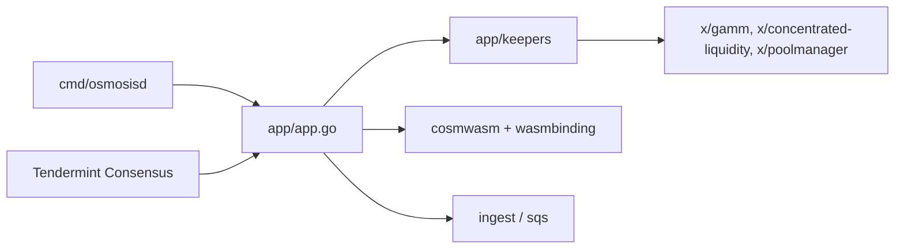

# osmosis-labs/osmosis

> Node of the Osmosis blockchain, the decentralized exchange of Cosmos, for validators and DeFi developers.

## The problem
Exchanging assets between Cosmos chains without a centralized intermediary requires a dedicated chain with built-in liquidity pools, fees and governance.

## What it actually does
Implements a Cosmos SDK application chain in Go: pool modules (GAMM, concentrated liquidity), locking, incentives, fees, IBC, CosmWasm contracts and ingestion services (`ingest`, `sqs`). The README points to docs.osmosis.zone to join the mainnet and offers LocalOsmosis, a containerized testnet.

## How it is wired

## Trying it
The README gives no command: it points to the official documentation (joining the mainnet, LocalOsmosis).

## Cost and gotchas
Recommended configuration: 4 amd64 cores, 64 GB of RAM (swap tolerated), 1 TB NVMe, 100 Mbit/s; ARM (M1) not supported. 181 open issues.

## What it is not
It is not a library nor a ready-to-use API: it is a full blockchain node. The README is mostly promotional.

## Alternatives
The README cites no alternative.

## For you
Ignore: heavy blockchain infrastructure, no use for a data/AI/MLOps profile apart from a specific interest in DeFi.
