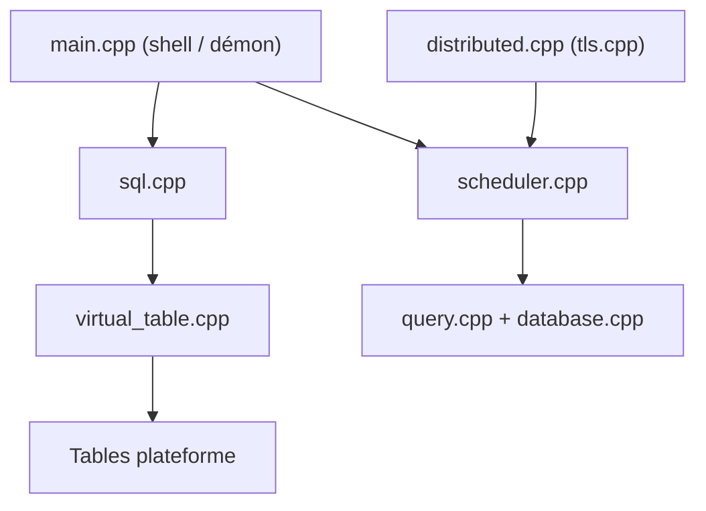

# osquery/osquery

> Exposes an operating system's state as a SQL database, for security monitoring and analysis.

## The problem
Querying processes, ports, kernel modules or files across several OSes requires different tools everywhere.

## What it actually does
Virtual SQL tables represent processes, listening ports, users, ARP caches, etc. Usable in the interactive shell `osqueryi`, as a scheduled daemon, or via the Thrift API. The daemon adds distributed queries, events, query packs, extensions and file carving. Linux, macOS, Windows.

## How it is wired


## Trying it
```sql
SELECT * FROM users;
SELECT * FROM processes WHERE on_disk = 0;
```

## Cost and gotchas
Free. Install via osquery.io/downloads. Managing a fleet requires a third-party tool (Fleet, Kolide, OSCTRL, Zentral), not endorsed by the project. License present but unidentified: to be checked.

## What it is not
Not a fleet management tool nor a turnkey EDR: it collects and queries, the rest is yours to build.

## Alternatives
Fleet, Kolide, OSCTRL and Zentral: fleet managers for osquery, not competitors.

## For you
Worth watching: useful for inventory and auditing of machines on an MLOps platform, outside the core of data / AI.
