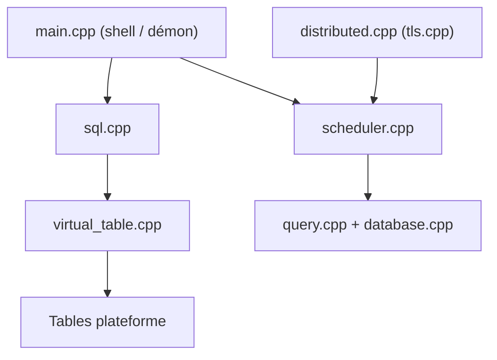

# osquery/osquery

> Expose l'état d'un système d'exploitation comme une base SQL, pour surveillance et analyse de sécurité.

## Le problème
Interroger processus, ports, modules noyau ou fichiers sur plusieurs OS demande des outils différents partout.

## Ce que ça fait vraiment
Des tables SQL virtuelles représentent processus, ports en écoute, utilisateurs, caches ARP, etc. Utilisable en shell interactif `osqueryi`, en démon planifié, ou via l'API Thrift. Le démon ajoute requêtes distribuées, événements, paquets de requêtes, extensions et file carving. Linux, macOS, Windows.

## Comment c'est branché


## Essayer
```sql
SELECT * FROM users;
SELECT * FROM processes WHERE on_disk = 0;
```

## Coût et pièges
Gratuit. Installation via osquery.io/downloads. Gérer une flotte demande un outil tiers (Fleet, Kolide, OSCTRL, Zentral), non recommandés par le projet. Licence présente mais non identifiée : à vérifier.

## Ce que ce n'est pas
Pas un outil de gestion de flotte ni un EDR clé en main : il collecte et interroge, le reste est à bâtir.

## Alternatives
Fleet, Kolide, OSCTRL et Zentral : gestionnaires de flotte pour osquery, pas des concurrents.

## Pour toi
À surveiller : utile pour l'inventaire et l'audit de machines d'une plateforme MLOps, hors du cœur data / IA.

