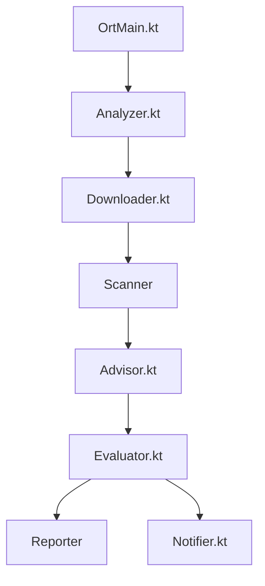

# oss-review-toolkit/ort

> Open source policy automation toolchain: dependencies, licenses, vulnerabilities, SBOM, for software teams.

## The problem
Knowing which dependencies and licenses a project ships, and proving it (SBOM, notices), is slow and manual.

## What it actually does
A staged pipeline: Analyzer (dependencies), Downloader (sources), Scanner (licenses and copyrights), Advisor (security advisories), Evaluator (policy rules as code), Reporter (reports, CycloneDX/SPDX SBOM) and Notifier (emails, JIRA tickets). Usable as a library, a CLI or in CI.

## How it is wired


## Trying it
```bash
docker run ghcr.io/oss-review-toolkit/ort --help
```

## Cost and gotchas
Java 25 is required for the binaries; the README recommends 8 GiB of memory and 4 cores. Large projects quickly drive up time and memory.

## What it is not
Not a tool to run in two minutes: it needs configuring (rules, classifications). It is not a malicious code scanner.

## Alternatives
No alternative named in the README.

## For you
Keep an eye on it: useful if you must deliver SBOMs or audit the licenses of an ML stack; otherwise too heavy for occasional use.
