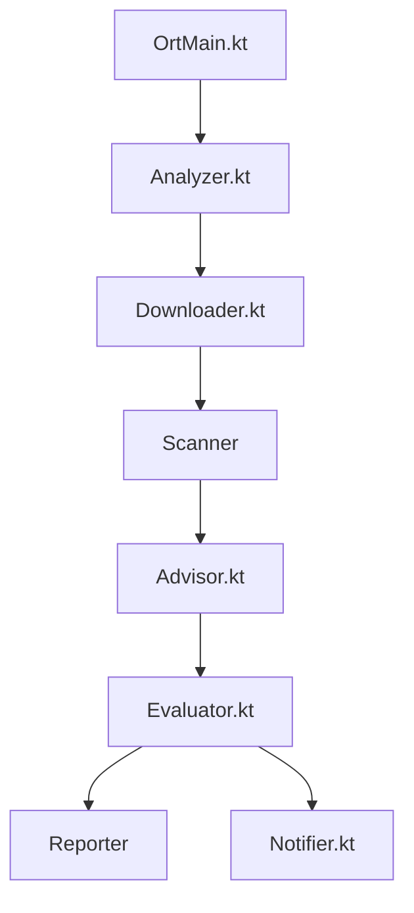

# oss-review-toolkit/ort

> Chaîne d'automatisation des politiques open source : dépendances, licences, vulnérabilités, SBOM, pour équipes logicielles.

## Le problème
Savoir quelles dépendances et licences un projet embarque, et le prouver (SBOM, notices), est long et manuel.

## Ce que ça fait vraiment
Pipeline en étapes : Analyzer (dépendances), Downloader (sources), Scanner (licences et copyrights), Advisor (avis de sécurité), Evaluator (règles de politique en code), Reporter (rapports, SBOM CycloneDX/SPDX) et Notifier (mails, tickets JIRA). Utilisable en bibliothèque, en CLI ou en CI.

## Comment c'est branché


## Essayer
```bash
docker run ghcr.io/oss-review-toolkit/ort --help
```

## Coût et pièges
Java 25 requis pour les binaires ; le README conseille 8 Gio de mémoire et 4 coeurs. Les gros projets font vite grimper temps et mémoire.

## Ce que ce n'est pas
Pas un outil à lancer en deux minutes : il se configure (règles, classifications). Ce n'est pas un scanner de code malveillant.

## Alternatives
Aucune alternative nommée dans le README.

## Pour toi
Surveiller : utile si tu dois livrer des SBOM ou auditer les licences d'une stack ML ; sinon trop lourd pour un usage ponctuel.

