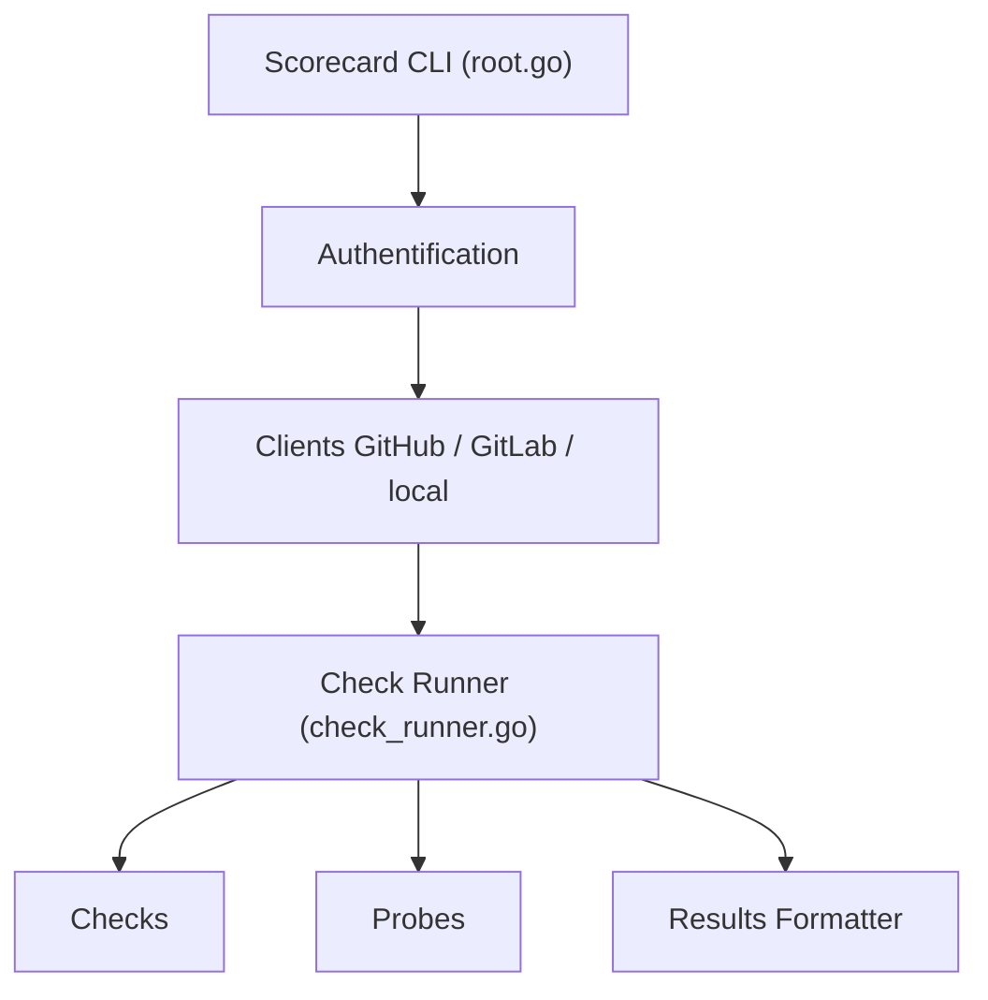

# ossf/scorecard

> Outil de l'OpenSSF qui note de 0 à 10 les pratiques de sécurité d'un dépôt open source.

## Le problème
Avant d'ajouter une dépendance, il est difficile de savoir si ses mainteneurs appliquent de bonnes pratiques de sécurité.

## Ce que ça fait vraiment
Scorecard lance une série de contrôles (Branch-Protection, Code-Review, Pinned-Dependencies, SAST, Signed-Releases, Vulnerabilities…) et note chacun, puis calcule un score agrégé. On l'utilise en CLI, en GitHub Action, via une API REST de scores précalculés, par badge, ou via un serveur MCP (`scorecard mcp`). Il vise GitHub, GitLab et du local ; l'analyse hebdomadaire couvre plus de 1,3 million de dépôts.

## Comment c'est branché


## Essayer
```bash
docker pull ghcr.io/ossf/scorecard:latest
export GITHUB_AUTH_TOKEN=<your access token>
scorecard --repo=github.com/ossf-tests/scorecard-check-branch-protection-e2e
scorecard --repo=github.com/ossf-tests/scorecard-check-branch-protection-e2e --checks Branch-Protection --show-details
```

## Coût et pièges
Gratuit. Un jeton GitHub est nécessaire pour éviter les limites de débit ; le README demande aussi Go installé pour la CLI et signale des problèmes possibles sous Windows. Les scores de l'API omettent trois contrôles trop coûteux à grande échelle.

## Ce que ce n'est pas
Pas un scanner de vulnérabilités du code et pas un verdict définitif : le README rappelle que les contrôles sont des heuristiques avec faux positifs et faux négatifs.

## Alternatives
Aucune alternative citée dans le README.

## Pour toi
À adopter pour évaluer les dépendances de tes projets ML avant de les figer, et pour auditer tes propres dépôts en CI ; l'outil est maintenu (push du 2026-10-19).

