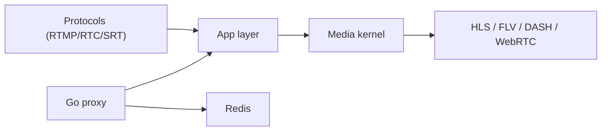

# ossrs/srs

> Real-time media server (RTMP, WebRTC, HLS, SRT…), for broadcasting and converting video streams.

## The problem
Receiving a stream (OBS, FFmpeg, camera) and redistributing it over several protocols requires a dedicated server and conversions.

## What it actually does
SRS receives RTMP, WebRTC, SRT, RTSP and GB28181 streams, normalizes them into internal stream objects, then serves them as HLS, HTTP-FLV, DASH, RTMP or WebRTC. It also does DVR, transcoding, relaying and origin/edge clusters. The C++ server (State Threads) is complemented by a Go proxy with load balancing via Redis. An "AI Agent" section recommends using an AI to understand it.

## How it is wired


## Trying it
```bash
docker run --rm -it -p 1935:1935 -p 1985:1985 -p 8080:8080 \
    -p 8000:8000/udp -p 10080:10080/udp ossrs/srs:6
ffmpeg -re -i ./doc/source.flv -c copy -f flv -y rtmp://localhost/live/livestream
```

## Cost and gotchas
Free. Several ports to open, including UDP. The README mentions SRS/8.0 in development; the Docker example uses the `:6` image.

## What it is not
Not a video editing or analysis tool: it transports and repackages streams.

## Alternatives
No alternative named in the README.

## For you
To keep an eye on: useful if you need to ingest live video streams for vision, otherwise outside your scope.
