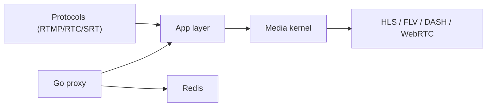

# ossrs/srs

> Serveur média temps réel (RTMP, WebRTC, HLS, SRT…), pour diffuser et convertir des flux vidéo.

## Le problème
Recevoir un flux (OBS, FFmpeg, caméra) et le redistribuer dans plusieurs protocoles demande un serveur dédié et des conversions.

## Ce que ça fait vraiment
SRS reçoit des flux RTMP, WebRTC, SRT, RTSP, GB28181, les normalise en objets de flux internes, puis les sert en HLS, HTTP-FLV, DASH, RTMP ou WebRTC. Il fait aussi DVR, transcodage, relais et grappes origine/bordure. Le serveur C++ (State Threads) est complété par un proxy Go avec équilibrage via Redis. Une section « AI Agent » recommande d'utiliser une IA pour le comprendre.

## Comment c'est branché


## Essayer
```bash
docker run --rm -it -p 1935:1935 -p 1985:1985 -p 8080:8080 \
    -p 8000:8000/udp -p 10080:10080/udp ossrs/srs:6
ffmpeg -re -i ./doc/source.flv -c copy -f flv -y rtmp://localhost/live/livestream
```

## Coût et pièges
Gratuit. Plusieurs ports à ouvrir, dont UDP. Le README mentionne SRS/8.0 en développement ; l'exemple Docker utilise l'image `:6`.

## Ce que ce n'est pas
Pas un outil de montage ni d'analyse vidéo : il transporte et reconditionne des flux.

## Alternatives
Aucune alternative nommée dans le README.

## Pour toi
À surveiller : utile si tu dois ingérer du flux vidéo en direct pour de la vision, sinon hors de ton périmètre.

