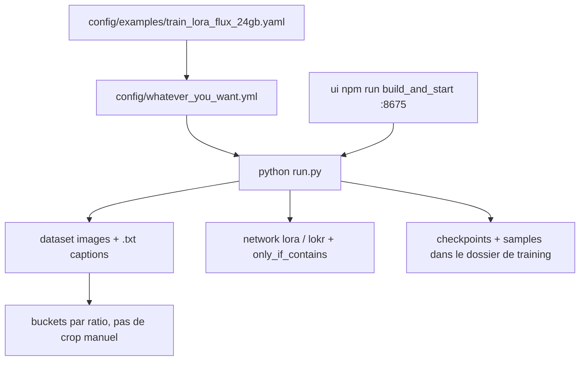

# ostris/ai-toolkit

> Training suite for image, video and audio diffusion models on consumer hardware.

## The problem
Every new diffusion model arrives with its own training script and memory constraints.
Keeping up with the release of FLUX, Qwen-Image, Wan or LTX otherwise means rewriting your pipeline every month.

## What it actually does
Trains LoRA and LoKr on a long catalog of image models (FLUX.1/2, Qwen-Image, SDXL, SD 1.5, HiDream, Z-Image…), instruction/editing, video (Wan 2.1/2.2, LTX-2.x, MiniMax-H3) and audio (Ace Step, YuE2).
Layer targeting is done with `only_if_contains` / `ignore_if_contains` on layer names in diffusers format.
An experimental manager (`python3 -m manager install|update|launch|doctor`) detects the hardware, creates the environment and bundles Node.js and FFmpeg in the project folder.
The web UI at `http://localhost:8675` starts, stops and monitors jobs; the CLI `python run.py config/xxx.yml` is enough without it.

## How it is wired


## Trying it
```bash
git clone https://github.com/ostris/ai-toolkit.git
cd ai-toolkit
./run_linux.sh
python3 -m manager install
python3 -m venv venv
source venv/bin/activate
pip3 install --no-cache-dir torch==2.13.0 torchvision==0.28.0 torchaudio==2.11.0 --index-url https://download.pytorch.org/whl/cu130
pip3 install -r requirements.txt
python run.py config/whatever_you_want.yml
cd ui && npm run build_and_start
```

## Cost and gotchas
Free, but "an Nvidia GPU with enough RAM for what you want to do": the bill is hardware, or rented (Ostris Cloud, RunPod, Modal — affiliate links openly disclosed).
Concrete pitfall: `Ctrl+C` during a save corrupts the checkpoint. The UI, if exposed, must be protected with `AI_TOOLKIT_AUTH`.

## What it is not
Not an image generation tool: it trains adapters, inference happens elsewhere.
Not a supported project: the author asks not to open issues other than code bugs and points to his Discord.
The installation manager is explicitly experimental, manual installation remains the safe route.

## Alternatives
- Tavris1/AI-Toolkit-Easy-Install: installation script recommended by the author for Windows.
- KohakuBlueleaf/LyCORIS: the reference cited for understanding and pushing LoKr.

## For you
Relevant only if you train diffusion LoRAs; otherwise it is a GPU tied up for nothing.
