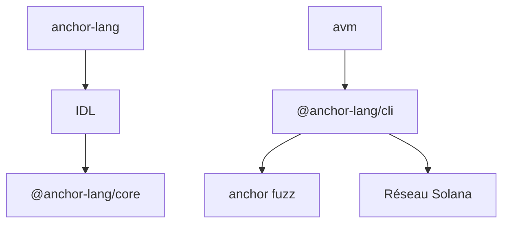

# otter-sec/anchor

> Rust framework, IDL and CLI for Solana programs, here under the name of a security firm.

## The problem
Writing a Solana program by hand means handling accounts, checks and generated clients.

## What it actually does
The README is identical to that of `solana-foundation/anchor` (same license, same dates and same figures in the catalog). It describes an embedded Rust language, an IDL, a TypeScript client and a CLI, plus `anchor fuzz` with Crucible. The installation script points to `otter-sec/anchor`. The exact link with the other repository (copy or source) is not documented.

## How it is wired
Simplified diagram based on the sheet, no diagram provided.



## Trying it
```bash
curl -sSfL https://raw.githubusercontent.com/otter-sec/anchor/master/avm/install | sh
avm nightly
avm nightly --disable
```

## Cost and gotchas
Free; Solana network fees at deployment. Nightly installation through a downloaded script: read it before running it.

## What it is not
Not a guaranteed distinct project: the README does not say whether it is a mirror. Not a data or AI tool.

## Alternatives
- solana-foundation/anchor: same content, the foundation's repository (cited by the same README links).

## For you
Ignore: duplicate of a blockchain framework outside the data, AI and MLOps scope.
