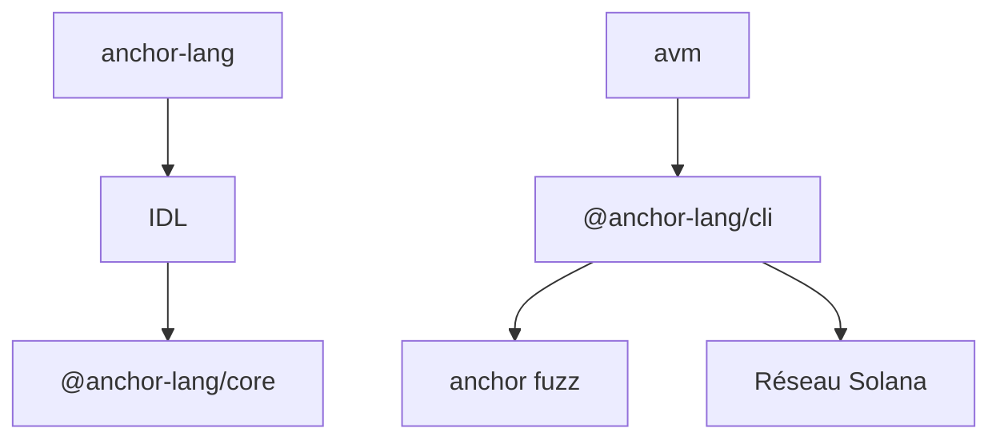

# otter-sec/anchor

> Framework Rust, IDL et CLI pour programmes Solana, ici sous le nom d'un cabinet de sécurité.

## Le problème
Écrire un programme Solana à la main impose de gérer comptes, vérifications et clients générés.

## Ce que ça fait vraiment
Le README est identique à celui de `solana-foundation/anchor` (même licence, mêmes dates et mêmes chiffres dans le catalogue). Il décrit un langage embarqué Rust, une IDL, un client TypeScript et une CLI, plus `anchor fuzz` avec Crucible. Le script d'installation pointe vers `otter-sec/anchor`. Le lien exact avec l'autre dépôt (copie ou source) n'est pas documenté.

## Comment c'est branché
Schéma simplifié d'après la fiche, sans diagramme fourni.



## Essayer
```bash
curl -sSfL https://raw.githubusercontent.com/otter-sec/anchor/master/avm/install | sh
avm nightly
avm nightly --disable
```

## Coût et pièges
Gratuit ; frais de réseau Solana au déploiement. Installation en nightly par script téléchargé : à relire avant exécution.

## Ce que ce n'est pas
Pas un projet distinct garanti : le README ne dit pas s'il s'agit d'un miroir. Pas un outil data ou IA.

## Alternatives
- solana-foundation/anchor : même contenu, dépôt de la fondation (cité par les mêmes liens du README).

## Pour toi
À ignorer : doublon d'un framework blockchain hors périmètre data, IA et MLOps.

