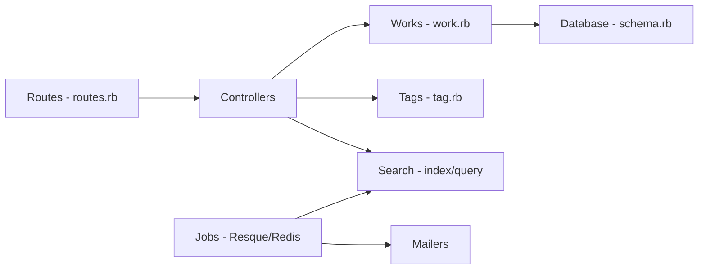

# otwcode/otwarchive

> Rails application for archiving fanfiction, fan art and videos, the engine of Archive of Our Own.

## The problem
Fan communities lack non-profit hosting with tags, collections and moderation suited to transformative works.

## What it actually does
Rails monolith (MVC, ERB views) centered on works (chapters, series, bookmarks, comments), a tag system with "wranglers", collections and challenges, moderation and Devise authentication. Search on a dedicated index, asynchronous Resque/Redis jobs, many mailers, i18n via Phrase.

## How it is wired

## Trying it
No command in the README; it points to the SquidgeWorld installation notes and the developer documentation.

## Cost and gotchas
Free. Heavy deployment: relational database, Redis, search index. No public API (stated). License GPL-2.0 or later.

## What it is not
Not a reusable component: it is the complete application of one specific site. Contributions go through Jira tracking.

## Alternatives
None named in the README.

## For you
Ignore: fanfiction platform, unrelated to data/AI/MLOps; only an example of a large Rails monolith.
