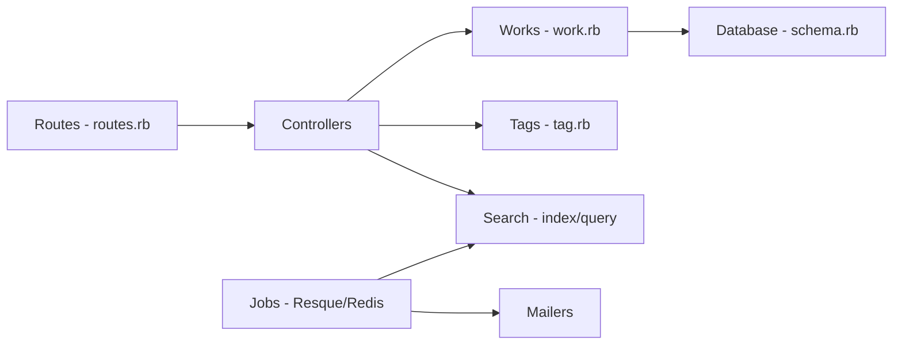

# otwcode/otwarchive

> Application Rails d'archivage de fanfictions, fan-art et vidéos, moteur de l'Archive of Our Own.

## Le problème
Les communautés de fans manquent d'un hébergement sans but lucratif, avec tags, collections et modération adaptés aux œuvres transformatives.

## Ce que ça fait vraiment
Monolithe Rails (MVC, vues ERB) centré sur les œuvres (chapitres, séries, signets, commentaires), un système de tags avec « wranglers », collections et défis, modération et authentification Devise. Recherche sur index dédié, tâches asynchrones Resque/Redis, nombreux mailers, i18n via Phrase.

## Comment c'est branché

## Essayer
Aucune commande dans le README ; il renvoie aux notes d'installation de SquidgeWorld et à la documentation développeur.

## Coût et pièges
Gratuit. Déploiement lourd : base relationnelle, Redis, index de recherche. Pas d'API publique (indiqué). Licence GPL-2.0 ou ultérieure.

## Ce que ce n'est pas
Ce n'est pas un composant réutilisable : c'est l'application complète d'un site précis. Les contributions passent par le suivi Jira.

## Alternatives
Aucune nommée dans le README.

## Pour toi
Ignorer : plateforme de fanfiction, sans lien avec data/IA/MLOps ; seulement un exemple de gros monolithe Rails.

