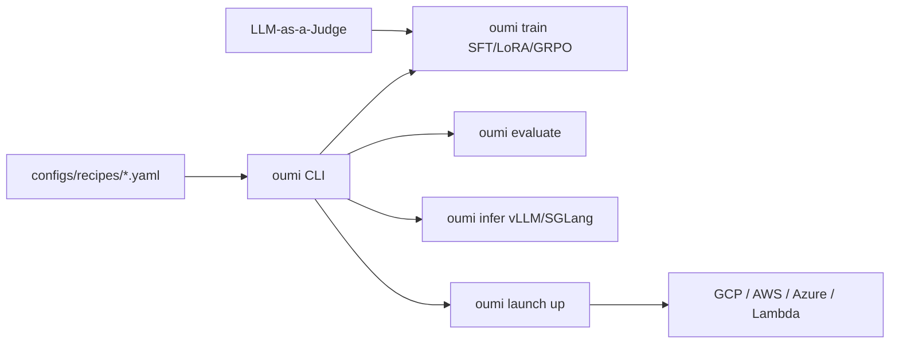

# oumi-ai/oumi

> Open platform covering data, training, evaluation and deployment of foundation models.

## The problem
Every stage of a model's lifecycle has its own tool: data preparation, SFT, LoRA, evaluation,
inference, cloud launch — and making them talk to each other costs more than each one taken alone.

## What it actually does
A single API and CLI: `oumi train`, `oumi evaluate`, `oumi infer`, `oumi launch up`, driven by
YAML recipe files. Covers fine-tuning from 10 M to 405 B parameters (SFT, LoRA, QLoRA, GRPO),
text and multimodal, data synthesis and curation with LLM judges, evaluation on
standard benchmarks, and deployment via vLLM or SGLang. `oumi launch` sends the same job to GCP,
AWS, Azure or Lambda by changing a single parameter. FSDP, DeepSpeed and DDP natively.

## How it is wired


## Trying it
```bash
uv pip install oumi
docker pull ghcr.io/oumi-ai/oumi:latest
oumi train -c configs/recipes/smollm/sft/135m/quickstart_train.yaml
oumi evaluate -c configs/recipes/smollm/evaluation/135m/quickstart_eval.yaml
oumi launch up -c configs/recipes/smollm/sft/135m/quickstart_gcp_job.yaml
```

## Cost and gotchas
The code is open; the compute is not. The recipes target GPUs, and the commercial integrations
(OpenAI, Anthropic, Vertex AI, Together, Parasail) require accounts and keys at your expense.
The quick install script is marked **experimental**.

## What it is not
Not stable: the README announces Oumi as beta, with a stable core but advanced features liable to
change. The model lists are not exhaustive, and only the entries ticked ✅ have actually been
tested and validated with a recipe. No license is stated in this README.

## Alternatives
No alternative repository is named in the README.

## For you
The promise is broad; test it on a validated recipe before making it a foundation.
