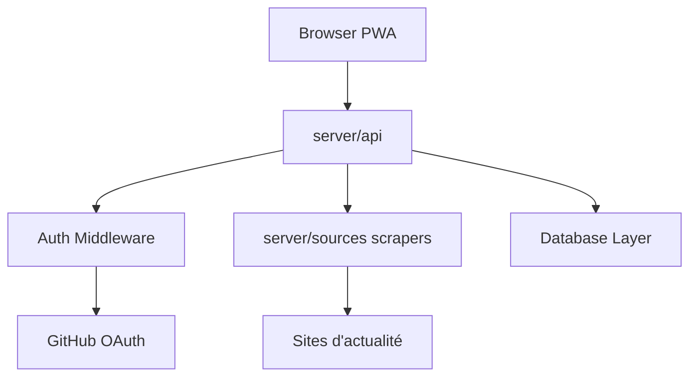

# ourongxing/newsnow

> Real-time, self-hostable news reader with an MCP server to plug in agents.

## The problem
Following trending news means browsing many sites; an agent has no unified feed.

## What it actually does
Scrapers in `server/sources` collect from sites (36kr, HackerNews, Zhihu...), a 30-minute cache limits requests, and the interval adapts to each source's update frequency. GitHub OAuth login for syncing; a `newsnow-mcp-server` package exposes the data to an MCP client.

## How it is wired


## Trying it
```bash
docker compose up
# développement
corepack enable
pnpm i
pnpm dev
```

## Cost and gotchas
Free; Cloudflare Pages/Vercel or Docker; a GitHub OAuth app must be created for login. Scraping: risk of IP blocking.

## What it is not
Not an official news API: it depends on third-party pages that may change. A "NewsNext" version is announced.

## Alternatives
No alternative named.

## For you
Watch: a handy MCP news source for agentic monitoring, fragile by nature (scraping).
