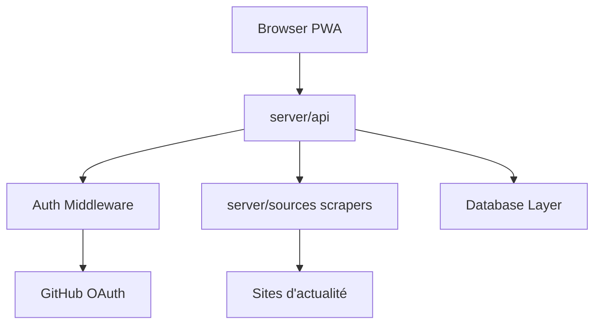

# ourongxing/newsnow

> Lecteur d'actualités en temps réel, auto-hébergeable, avec serveur MCP pour brancher des agents.

## Le problème
Suivre l'actualité tendance demande de parcourir de nombreux sites ; un agent n'a pas de flux unifié.

## Ce que ça fait vraiment
Des scrapers dans `server/sources` collectent des sites (36kr, HackerNews, Zhihu…), un cache de 30 minutes limite les requêtes, l'intervalle s'adapte à la fréquence de la source. Connexion GitHub OAuth pour synchroniser ; un paquet `newsnow-mcp-server` expose les données à un client MCP.

## Comment c'est branché


## Essayer
```bash
docker compose up
# développement
corepack enable
pnpm i
pnpm dev
```

## Coût et pièges
Gratuit ; Cloudflare Pages/Vercel ou Docker ; OAuth GitHub à créer pour le login. Scraping : risque de blocage IP.

## Ce que ce n'est pas
Pas une API d'actualité officielle : dépend de pages tierces susceptibles de changer. Une version « NewsNext » est annoncée.

## Alternatives
Aucune alternative nommée.

## Pour toi
Surveiller : une source d'actualités MCP pratique pour une veille agentique, fragile par nature (scraping).

