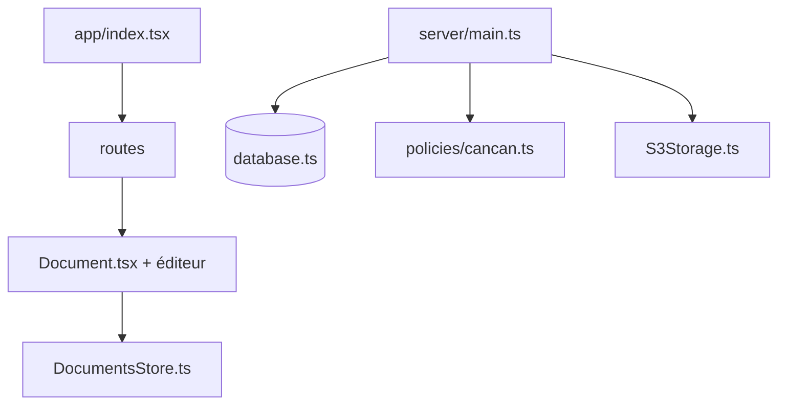

# outline/outline

> Collaborative knowledge base for teams, in React and Node.js, hosted or self-hosted.

## The problem
Teams lose their documentation in closed or scattered tools, with no search or collaborative editing.

## What it actually does
Collections and documents, rich editor, comments, sharing, templates, import, search, webhooks, GitHub and GitLab integrations. Node server with a database, S3 storage, policy-based authorizations.

## How it is wired


## Trying it
```bash
make test
yarn db:migrate
yarn test:server
```
For installation, the README points to the documentation and the Docker images.

## Cost and gotchas
Hosted is paid (getoutline.com); self-hosting is free but requires a database, file storage and authentication setup.

## What it is not
Not a wiki ready to launch in one command. The license is present but not identified by GitHub: to be checked.

## Alternatives
No alternative named in the README.

## For you
Watch: a good team wiki for an MLOps project's documentation, subject to reading the license.
