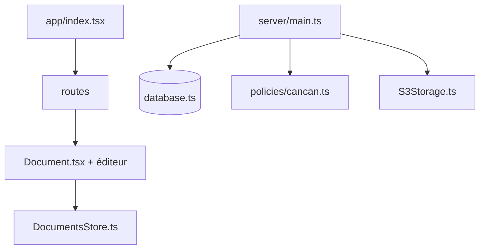

# outline/outline

> Base de connaissances collaborative pour équipes, en React et Node.js, hébergée ou auto-hébergée.

## Le problème
Les équipes perdent leur documentation dans des outils fermés ou dispersés, sans recherche ni édition collaborative.

## Ce que ça fait vraiment
Collections et documents, éditeur riche, commentaires, partage, modèles, import, recherche, webhooks, intégrations GitHub et GitLab. Serveur Node avec base de données, stockage S3, autorisations par politiques.

## Comment c'est branché


## Essayer
```bash
make test
yarn db:migrate
yarn test:server
```
Pour l'installation, le README renvoie à la documentation et aux images Docker.

## Coût et pièges
Hébergé payant (getoutline.com) ; auto-hébergement gratuit mais demande base de données, stockage de fichiers et configuration d'authentification.

## Ce que ce n'est pas
Pas un wiki prêt à lancer en une commande. La licence est présente mais non identifiée par GitHub : à vérifier.

## Alternatives
Aucune alternative nommée dans le README.

## Pour toi
À surveiller : bon wiki d'équipe pour la doc d'un projet MLOps, sous réserve de lire la licence.

