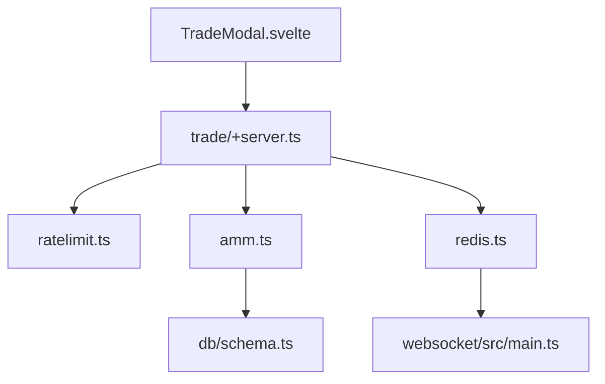

# outpoot/rugplay

> Simulator for trading fictional cryptocurrencies, with liquidity pools, prediction markets and games.

## The problem
Learning how decentralized exchanges and "rug pulls" work without risking real money.

## What it actually does
A trade goes from the Svelte modal to the API, passes through rate limiting and the AMM logic, then PostgreSQL. A websocket server (Bun) broadcasts updates via Redis. Google OAuth login.

## How it is wired


## Trying it
```bash
cd website/websocket && bun install
cd .. && npm install --include=dev
cd websocket && bun run src/main.ts
cd .. && npm run dev
```

## Cost and gotchas
Free locally. Requires Redis, PostgreSQL (Docker), Bun and a Google OAuth client; AWS and OpenRouter are optional.

## What it is not
Not a real trading tool: everything is fictional.

## Alternatives
No alternative named in the README.

## For you
Ignore: simulation game unrelated to data/AI; the stack remains a complete SvelteKit example.
