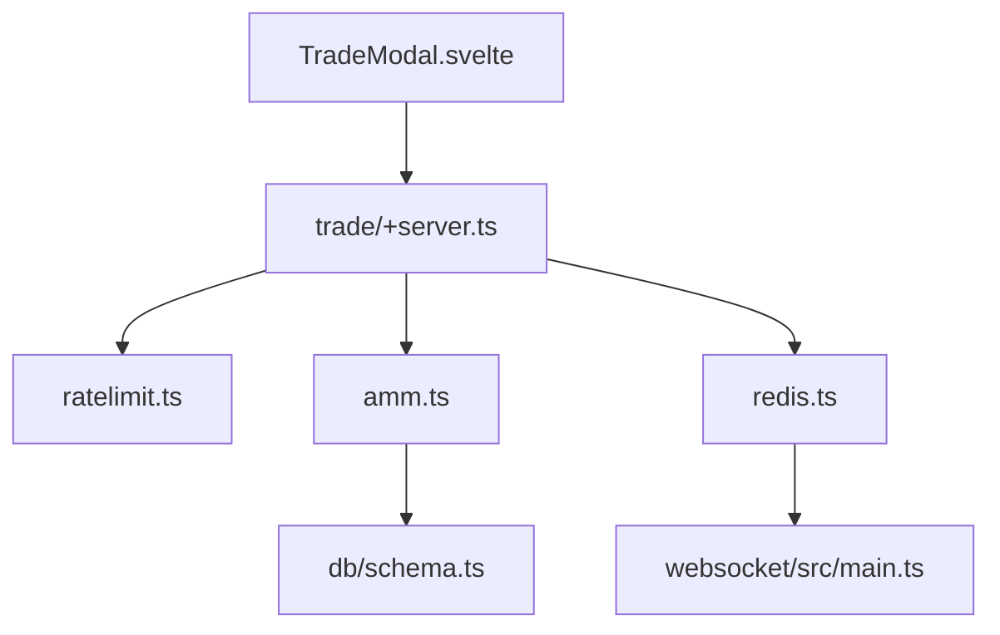

# outpoot/rugplay

> Simulateur de trading de cryptomonnaies fictives avec pools de liquidité, marchés de prédiction et jeux.

## Le problème
Apprendre le fonctionnement des échanges décentralisés et des « rug pulls » sans risquer d'argent réel.

## Ce que ça fait vraiment
Un trade part du modal Svelte vers l'API, passe la limitation de débit et la logique AMM, puis PostgreSQL. Un serveur websocket (Bun) diffuse les mises à jour via Redis. Connexion Google OAuth.

## Comment c'est branché


## Essayer
```bash
cd website/websocket && bun install
cd .. && npm install --include=dev
cd websocket && bun run src/main.ts
cd .. && npm run dev
```

## Coût et pièges
Gratuit en local. Il faut Redis, PostgreSQL (Docker), Bun, un client Google OAuth ; AWS et OpenRouter optionnels.

## Ce que ce n'est pas
Pas un outil de trading réel : tout est fictif.

## Alternatives
Aucune alternative nommée dans le README.

## Pour toi
À ignorer : jeu de simulation sans lien avec data/IA ; la pile reste un exemple SvelteKit complet.

