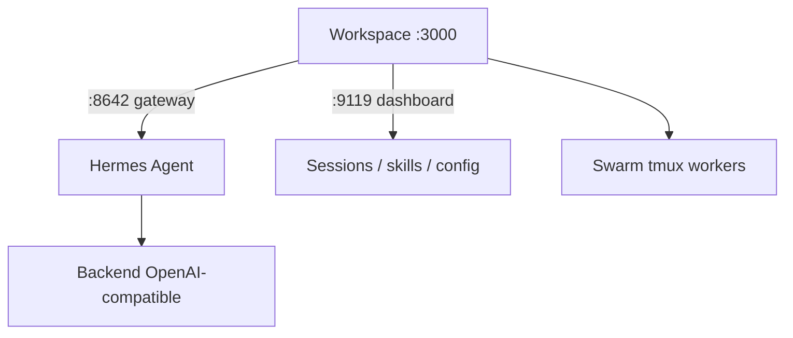

# outsourc-e/hermes-workspace

> Web interface ("command center") for a Hermes agent: chat, files, memory, skills, terminal.

## The problem
Driving a Hermes agent scatters chat, memory, skills, jobs and terminal across several surfaces. There is no single control post.

## What it actually does
A zero-fork UI running on vanilla `NousResearch/hermes-agent`: SSE chat, editable memory, 2000+ skills, an MCP page, file browser + PTY terminal, dashboard, Swarm Mode (persistent tmux workers with role-based dispatch), Conductor (mission dispatch). PWA + Tailscale, security (auth on every route, CSP, fail-closed). Compatible with any OpenAI-compatible backend (Ollama, LM Studio, vLLM).

## How it is wired


## Trying it
```bash
curl -fsSL https://raw.githubusercontent.com/outsourc-e/hermes-workspace/main/install.sh | bash
```
```bash
hermes gateway run
cd ~/hermes-workspace && pnpm dev
```

## Cost and gotchas
Free; an LLM provider key is required (or a local server). Node 22+. Depends on a working `hermes-agent` (two services). The README is truncated at the end (content spilling over from the description). Cloud/native desktop features are "coming soon".

## What it is not
Not an agent: it is the UI; the brain is Hermes Agent. Not a simple chat wrapper according to the authors, but dependent on a specific stack.

## Alternatives
Not named in the README (it mentions Ollama/LM Studio/vLLM as backends).

## For you
Tightly tied to the Hermes/Nous ecosystem; outside your usual stack and experimental status — ignore unless you have a dedicated Hermes use.
