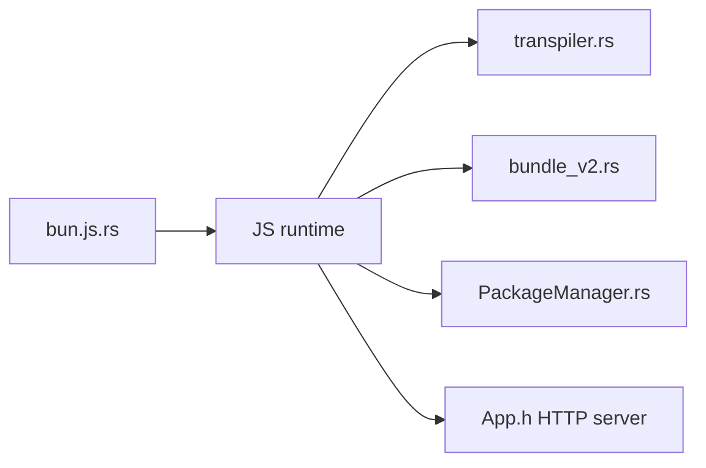

# oven-sh/bun

> JavaScript and TypeScript toolkit in a single executable: runtime, package manager, bundler and test runner.

## The problem
A Node project assembles a runtime, npm, a bundler and a test runner, each with its own configuration and slowness.

## What it actually does
The `bun` binary runs TS and JSX directly, replaces npm (`bun install`), runs tests (`bun test`) and the bundler. It presents itself as a drop-in replacement for Node.js, written in Rust on JavaScriptCore. It bundles an HTTP server, WebSockets, SQLite, Postgres, Redis, S3, a shell, and runs packages with `bunx`. Many guides are listed.

## How it is wired


## Trying it
```bash
curl -fsSL https://bun.com/install | bash
bun run index.tsx
bun test
bun install <pkg>
bunx cowsay 'Hello, world!'
```

## Cost and gotchas
Free. Linux kernel 5.6 or later recommended. 9,246 open issues. The license present is not identified by GitHub.

## What it is not
Not a guaranteed identical Node.js: compatibility is a goal. The README is mostly an index of links.

## Alternatives
No alternative named in the README.

## For you
Worth watching: tempting for fast web tooling, but check the license and your Node compatibility before migrating.
