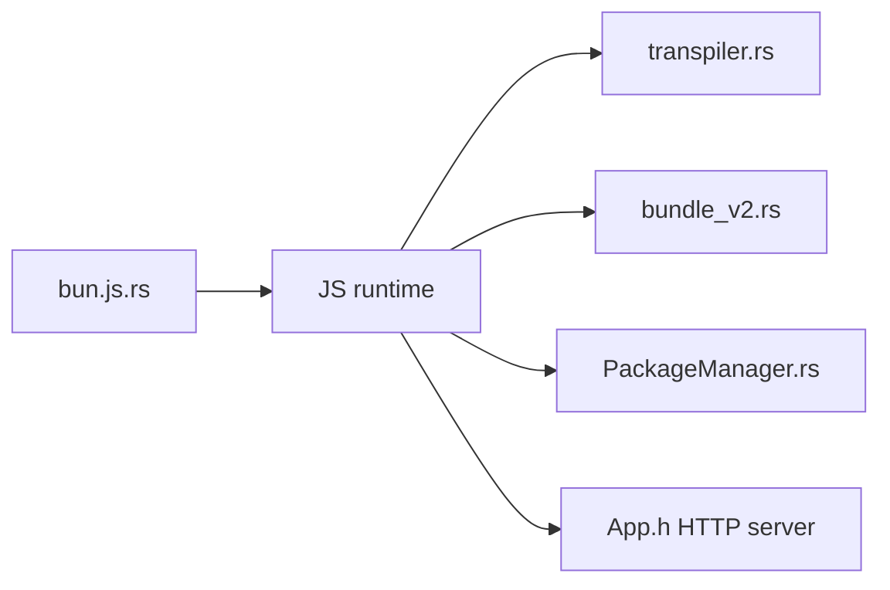

# oven-sh/bun

> Boîte à outils JavaScript et TypeScript en un exécutable : runtime, gestionnaire de paquets, bundler et tests.

## Le problème
Un projet Node assemble runtime, npm, bundler et exécuteur de tests, chacun avec sa configuration et ses lenteurs.

## Ce que ça fait vraiment
Le binaire `bun` exécute TS et JSX directement, remplace npm (`bun install`), lance les tests (`bun test`) et le bundler. Il se présente comme un substitut de Node.js, écrit en Rust sur JavaScriptCore. Il embarque serveur HTTP, WebSockets, SQLite, Postgres, Redis, S3, shell, et exécute des paquets avec `bunx`. De nombreux guides sont listés.

## Comment c'est branché


## Essayer
```bash
curl -fsSL https://bun.com/install | bash
bun run index.tsx
bun test
bun install <pkg>
bunx cowsay 'Hello, world!'
```

## Coût et pièges
Gratuit. Noyau Linux 5.6 ou plus recommandé. 9 246 issues ouvertes. La licence présente n'est pas identifiée par GitHub.

## Ce que ce n'est pas
Pas un Node.js garanti identique : la compatibilité est un objectif. Le README est surtout un index de liens.

## Alternatives
Aucune alternative nommée dans le README.

## Pour toi
À surveiller : tentant pour des outils web rapides, mais vérifie la licence et ta compatibilité Node avant de migrer.

