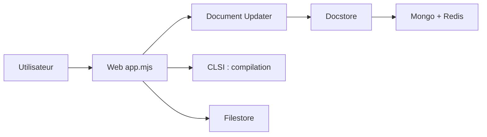

# overleaf/overleaf

> Real-time collaborative LaTeX editor, self-hostable, Community edition.

## The problem
Writing LaTeX papers as a group, without installing TeX Live or exchanging files by e-mail.

## What it actually does
Multi-service web application: the web service handles projects and websockets, `document-updater` maintains document state and history, CLSI compiles the LaTeX, `docstore` and `filestore` persist texts and files; chat, a Git bridge and a spell checker complete it. The Docker image `sharelatex/sharelatex` builds on a base image with TeX Live and the runit manager. SSO/LDAP and track-changes features are reserved for Server Pro.

## How it is wired


## Trying it
```bash
cd server-ce
make build-base
make build-community
```
The usual installation goes through the Overleaf Toolkit (not detailed in the README).

## Cost and gotchas
Free in Community; heavy image (TeX Live). Updates require reading the release notes version by version. AGPL: obligations if you modify and expose the service.

## What it is not
It is not the full SaaS version: SSO and track changes are missing in Community.

## Alternatives
Overleaf Server Pro (cited), a supported version with more features.

## For you
Worth watching: relevant if your team writes publications and wants to host its data; of no direct interest for the ML chain.
