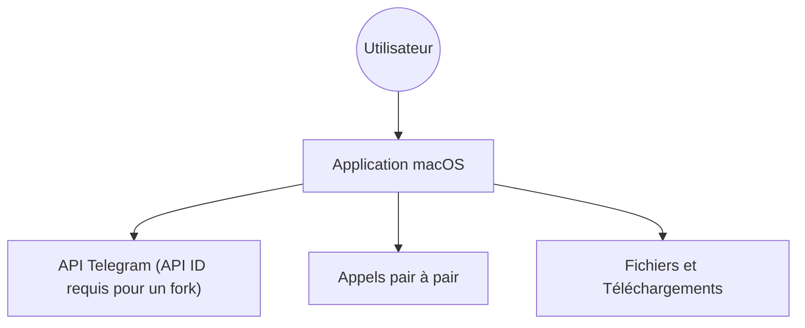

# overtake/TelegramSwift

> Source code of the official Telegram client for macOS, for Mac users and forkers.

## The problem
Using Telegram on a Mac requires a fast, up-to-date native client.

## What it actually does
A messaging client in Swift: messages, voice calls, file sending, location, notifications. The README lists the permissions requested: microphone, camera, location, network, files. Installation via Homebrew, `mas` or download.

## How it is wired
Simplified diagram based on the sheet, no diagram provided.


## Trying it
```bash
brew cask install telegram
mas install 747648890
```

## Cost and gotchas
Free. A fork requires its own API ID, a different name and a different logo, and publication of the code (GPL-2.0). Build instructions in INSTALL.md. 991 open issues, last push September 2025.

## What it is not
Not a reusable library. Not a cross-platform client: macOS only.

## Alternatives
No alternative named in the README.

## For you
Ignore: a macOS messaging client, of no interest for data / AI / MLOps work.
