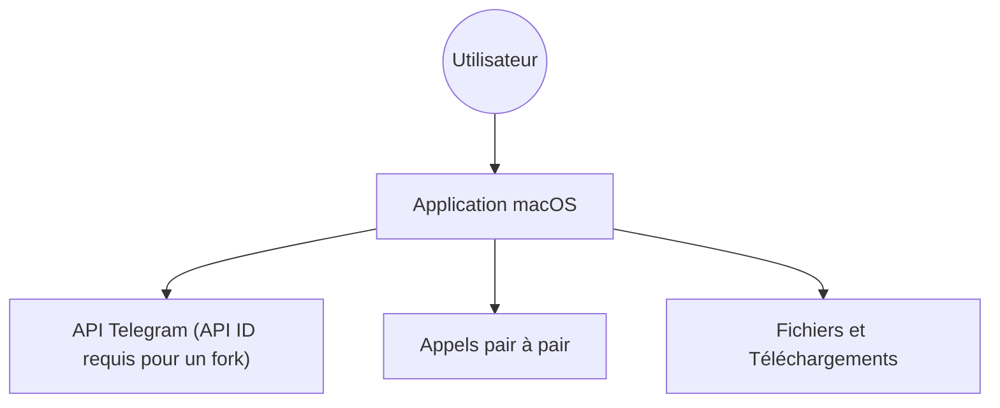

# overtake/TelegramSwift

> Code source du client Telegram officiel pour macOS, pour utilisateurs Mac et forkeurs.

## Le problème
Utiliser Telegram sur Mac demande un client natif rapide et à jour.

## Ce que ça fait vraiment
Client de messagerie en Swift : messages, appels vocaux, envoi de fichiers, localisation, notifications. Le README liste les permissions demandées : micro, caméra, position, réseau, fichiers. Installation par Homebrew, `mas` ou téléchargement.

## Comment c'est branché
Schéma simplifié d'après la fiche, sans diagramme fourni.


## Essayer
```bash
brew cask install telegram
mas install 747648890
```

## Coût et pièges
Gratuit. Un fork exige son propre API ID, un autre nom et un autre logo, et la publication du code (GPL-2.0). Instructions de build dans INSTALL.md. 991 issues ouvertes, dernier push septembre 2025.

## Ce que ce n'est pas
Pas une bibliothèque réutilisable. Pas un client multiplateforme : macOS seulement.

## Alternatives
Aucune alternative nommée dans le README.

## Pour toi
Ignorer : client de messagerie macOS, sans intérêt pour un travail data / IA / MLOps.

