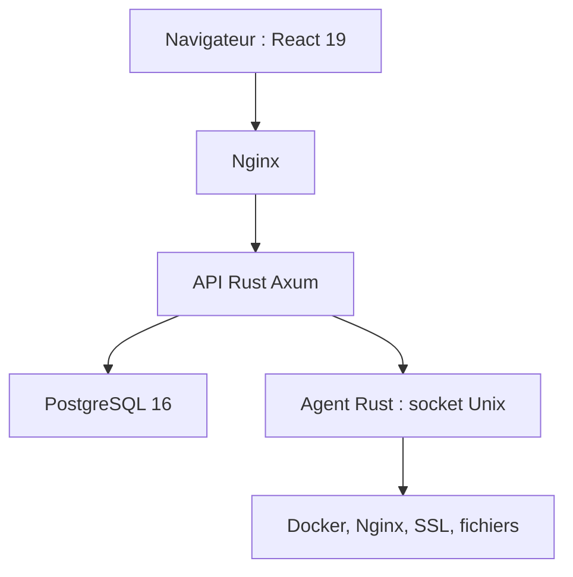

# ovexro/dockpanel

> Self-hosted Linux server administration panel, written in Rust, centered on Docker.

## The problem
Hosting sites, databases, Docker applications, backups and DNS on a server takes a lot of manual configuration or a paid panel.

## What it actually does
Manages sites (Nginx, SSL, PHP, Node, Python), MySQL and PostgreSQL databases, 147 Docker application templates, Git deployment, backups, DNS, mail, firewall and image vulnerability scanning. A read-only MCP server, disabled by default, exposes about 40 inspection tools.

## How it is wired


## Trying it
```bash
curl -sL https://dockpanel.dev/install.sh | sudo bash
dockpanel status
dockpanel diagnose
```

## Cost and gotchas
Free, but the script runs as root on your server. Without a domain, the certificate is self-signed. The mail server is refused on the RHEL family.

## What it is not
It is not the WPF window component of the same name. The README admits that some features remain incomplete, for example provider API tokens that do not authenticate yet.

## Alternatives
HestiaCP, CloudPanel and RunCloud, compared in the README table.

## For you
Keep an eye on it: interesting for hosting your own AI services on a server, but install it on a disposable machine first and do not rely on the README's figures.
