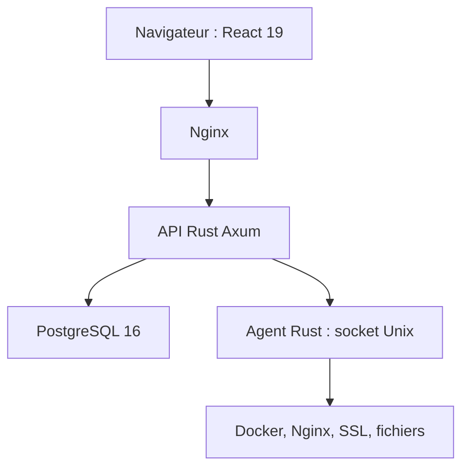

# ovexro/dockpanel

> Panneau d'administration de serveur Linux auto-hébergé, écrit en Rust, centré sur Docker.

## Le problème
Héberger sites, bases, applications Docker, sauvegardes et DNS sur un serveur demande beaucoup de configuration manuelle ou un panneau payant.

## Ce que ça fait vraiment
Gère sites (Nginx, SSL, PHP, Node, Python), bases MySQL et PostgreSQL, 147 modèles d'applications Docker, déploiement par Git, sauvegardes, DNS, courrier, pare-feu et analyse de vulnérabilités des images. Un serveur MCP en lecture seule, désactivé par défaut, expose environ 40 outils d'inspection.

## Comment c'est branché


## Essayer
```bash
curl -sL https://dockpanel.dev/install.sh | sudo bash
dockpanel status
dockpanel diagnose
```

## Coût et pièges
Gratuit, mais le script s'exécute en root sur ton serveur. Sans domaine, le certificat est auto-signé. Le serveur de courrier est refusé sur la famille RHEL.

## Ce que ce n'est pas
Ce n'est pas le composant de fenêtres WPF du même nom. Le README admet que des fonctions restent incomplètes, par exemple des jetons de l'API fournisseur qui n'authentifient pas encore.

## Alternatives
HestiaCP, CloudPanel et RunCloud, comparés dans le tableau du README.

## Pour toi
À surveiller : intéressant pour héberger tes propres services d'IA sur un serveur, mais installe-le sur une machine jetable d'abord et ne dépends pas des chiffres du README.

