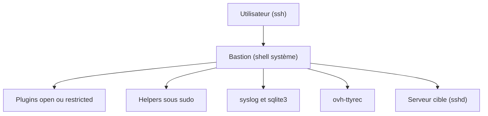

# ovh/the-bastion

> OVH's SSH bastion: a single, audited and partitioned entry point to servers, for operations teams.

## The problem
Without a single entry point, every server knows every administrator and it becomes hard to control and trace access.

## What it actually does
Administrators have an individual account and belong to groups; the infrastructure only trusts the groups. SSH protocol break between entry and exit, session recording (ttyrec), syslog logs, MFA (password, TOTP), Yubico PIV keys, mosh, scp/sftp/rsync, HTTPS proxy. No database required; Perl code, accounts and groups mapped onto the UNIX system.

## How it is wired


## Trying it
```bash
docker run -d -p 22 --name bastiontest ovhcom/the-bastion:sandbox
docker exec -it bastiontest /opt/bastion/bin/admin/setup-first-admin-account.sh poweruser auto
bastion --osh info
```

## Cost and gotchas
Free. The Docker sandbox is for trials; production requires installation and configuration (`/etc/bastion/bastion.conf`), ideally in a cluster. License present but not identified by GitHub.

## What it is not
Not a VPN nor a secrets manager: it controls and records SSH access. The README warns to read the FAQ before containerizing in production.

## Alternatives
No alternative named in the README.

## For you
Worth watching if you manage GPU servers or MLOps production with audit requirements; otherwise too heavy.
