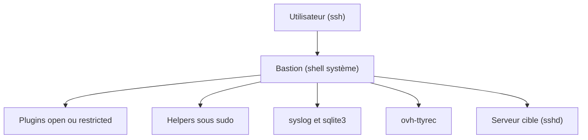

# ovh/the-bastion

> Bastion SSH d'OVH : point d'entrée unique, audité et cloisonné vers les serveurs, pour équipes d'exploitation.

## Le problème
Sans point d'entrée unique, chaque serveur connaît chaque administrateur et il devient difficile de contrôler et de tracer les accès.

## Ce que ça fait vraiment
Les administrateurs ont un compte individuel et appartiennent à des groupes ; l'infrastructure ne fait confiance qu'aux groupes. Rupture de protocole SSH entre entrée et sortie, enregistrement des sessions (ttyrec), journaux syslog, MFA (mot de passe, TOTP), clés Yubico PIV, mosh, scp/sftp/rsync, proxy HTTPS. Aucune base de données requise ; code Perl, comptes et groupes mappés sur le système UNIX.

## Comment c'est branché


## Essayer
```bash
docker run -d -p 22 --name bastiontest ovhcom/the-bastion:sandbox
docker exec -it bastiontest /opt/bastion/bin/admin/setup-first-admin-account.sh poweruser auto
bastion --osh info
```

## Coût et pièges
Gratuit. Le bac à sable Docker sert aux essais ; la production demande installation et configuration (`/etc/bastion/bastion.conf`), idéalement en cluster. Licence présente mais non identifiée par GitHub.

## Ce que ce n'est pas
Pas un VPN ni un gestionnaire de secrets : il contrôle et enregistre les accès SSH. Le README prévient de lire la FAQ avant la conteneurisation en production.

## Alternatives
Aucune alternative nommée dans le README.

## Pour toi
À surveiller si tu gères des serveurs GPU ou de la prod MLOps avec exigences d'audit ; sinon trop lourd.

