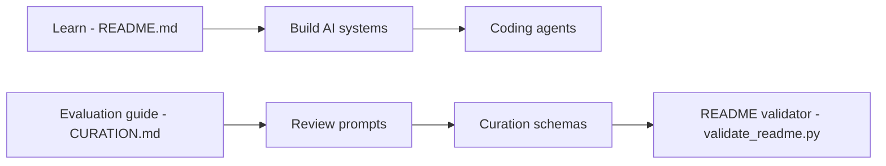

# owainlewis/awesome-artificial-intelligence

> Selective list of resources for developers building generative AI systems and agents.

## The problem
Sorting through the mass of resources on LLMs and agents, and keeping only what has technical depth.

## What it actually does
README organized in three parts: learn (books, courses, foundational papers), build (guides, MCP and A2A protocols, agent frameworks, retrieval, evals, deployment with vLLM, LiteLLM, Langfuse) and agentic software engineering (Claude Code, Codex CLI, Aider, OpenHands…). Weekly review by automation; a script validates the README.

## How it is wired

## Trying it
No command documented in the README: the list is read online.

## Cost and gotchas
Free. The README promotes a "starter pack" and a paid program by the same author.

## What it is not
Not an exhaustive directory of products: the README embraces opinion and selectivity. Not a tool to run.

## Alternatives
No alternative named in the README.

## For you
Watch: a good starting point to map the agents/LLM ecosystem, keeping in mind the author's commercial bias.
