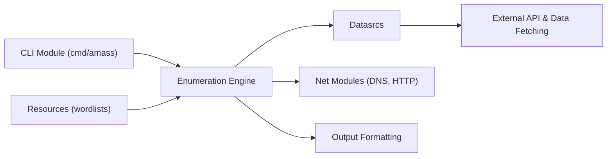

# owasp-amass/amass

> OWASP tool for attack surface mapping and external asset discovery, for security teams.

## The problem
Knowing which domains, subdomains and addresses of an organization are exposed on the Internet, without listing them by hand.

## What it actually does
The README is only a few lines long: network mapping and asset discovery through open sources (OSINT) and active reconnaissance. The rest comes from the architecture description, generated from the file tree: a command-line Go tool, an enumeration engine (`enum`), data sources and scripts (`datasrcs`), DNS/HTTP network modules, output formats. These details are not confirmed by the README.

## How it is wired

## Trying it
No command is documented in the README: it points to the Amass documentation repository for installation (Go, Docker Hub and releases badges).

## Cost and gotchas
Not documented in the README. The architecture indicates integrations with many external APIs, which generally require keys specific to each service. A license is present but not identified by GitHub: read it before reuse.

## What it is not
It is not a data science or MLOps tool. Active reconnaissance sends requests to the targets: only run it on a scope you are authorized to test.

## Alternatives
The README does not name any other repository.

## For you
Ignore: an offensive/defensive security tool outside your data/AI/MLOps scope, and too little material to judge further; revisit only if you audit the exposure of your own services.
