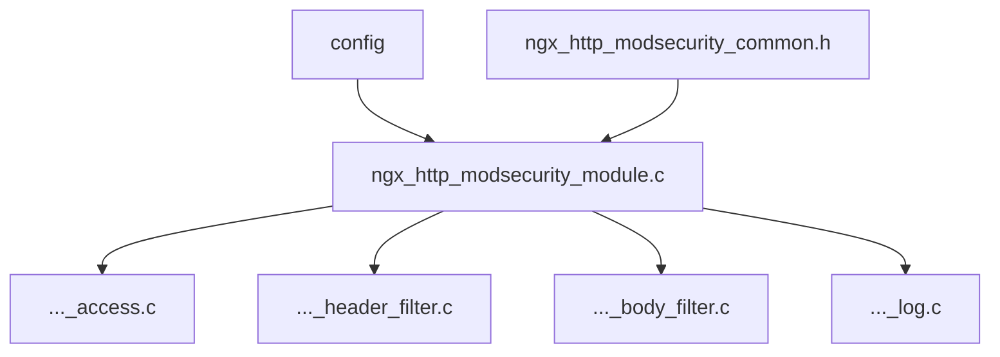

# owasp-modsecurity/ModSecurity-nginx

> nginx module that connects the server to the libmodsecurity web application firewall (ModSecurity v3).

## The problem
Filtering malicious requests in front of an nginx site requires plugging in a WAF rules engine.

## What it actually does
An nginx module that passes requests, headers, bodies and logs to libmodsecurity. It adds five directives: `modsecurity`, `modsecurity_rules_file`, `modsecurity_rules_remote`, `modsecurity_rules` and `modsecurity_transaction_id`, plus `modsecurity_use_error_log`. Rules can vary per `location`.

## How it is wired


## Trying it
```bash
./configure --add-module=/path/to/ModSecurity-nginx
./configure --add-dynamic-module=/path/to/ModSecurity-nginx --with-compat
```

## Cost and gotchas
Free. Requires libmodsecurity to be installed and nginx to be recompiled; as a dynamic module, the nginx version must match. Works with v3, not with ModSecurity 2.9 or earlier.

## What it is not
Not a rule set: you must supply or download your own rules. Nor is it an offensive tool, it is a firewall.

## Alternatives
The old standalone ModSecurity module for nginx, which the README describes as worse (more dependencies, more bugs).

## For you
Ignore: useful if you expose a service behind nginx, but not core data / AI / MLOps.
