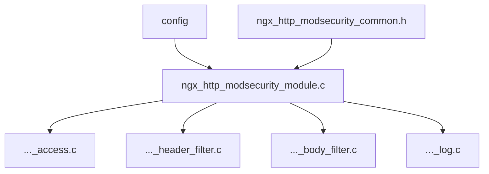

# owasp-modsecurity/ModSecurity-nginx

> Module nginx qui relie le serveur au pare-feu applicatif libmodsecurity (ModSecurity v3).

## Le problème
Filtrer les requêtes malveillantes devant un site nginx demande de brancher un moteur de règles WAF.

## Ce que ça fait vraiment
Module nginx qui transmet requêtes, en-têtes, corps et journaux à libmodsecurity. Il ajoute cinq directives : `modsecurity`, `modsecurity_rules_file`, `modsecurity_rules_remote`, `modsecurity_rules` et `modsecurity_transaction_id`, plus `modsecurity_use_error_log`. Les règles peuvent varier par `location`.

## Comment c'est branché


## Essayer
```bash
./configure --add-module=/path/to/ModSecurity-nginx
./configure --add-dynamic-module=/path/to/ModSecurity-nginx --with-compat
```

## Coût et pièges
Gratuit. Exige libmodsecurity installée et une recompilation de nginx ; en module dynamique, la version de nginx doit correspondre. Fonctionne avec v3, pas avec ModSecurity 2.9 ou moins.

## Ce que ce n'est pas
Pas un jeu de règles : il faut fournir ou télécharger ses propres règles. Ce n'est pas non plus un outil offensif, c'est un pare-feu.

## Alternatives
L'ancien module ModSecurity autonome pour nginx, que le README décrit comme moins bon (plus de dépendances, plus de bogues).

## Pour toi
À ignorer : utile si tu exposes un service derrière nginx, mais ce n'est pas du cœur data / IA / MLOps.

