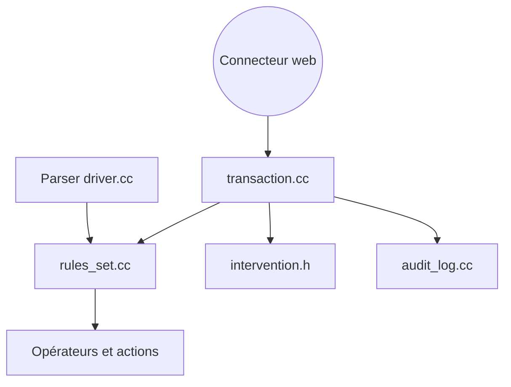

# owasp-modsecurity/ModSecurity

> C++ web application firewall library, applying SecRules through server connectors.

## The problem
Filtering malicious HTTP traffic requires a rules engine independent of the web server.

## What it actually does
libmodsecurity loads rules in SecRules format and applies them in phases to the requests and responses supplied by a connector (Nginx for example, separate repository). It returns an intervention decision, maintains persistent collections and writes audit and debug logs. A rewrite of ModSecurity v2 with no dependency on Apache.

## How it is wired


## Trying it
```bash
git submodule update --init --recursive
./build.sh
./configure
make
sudo make install
```

## Cost and gotchas
Free. Compilation with mandatory submodules (libinjection, mbedtls), C++17, Flex/Bison, YAJL. Without a rule set, protection is minimal.

## What it is not
Not a ready-to-use product: without a connector and rules (OWASP CRS), it filters nothing. It is no longer the Apache v2 module.

## Alternatives
No alternative named in the README.

## For you
Worth watching: useful only if you expose an API or a model yourself behind Nginx and want basic filtering.
