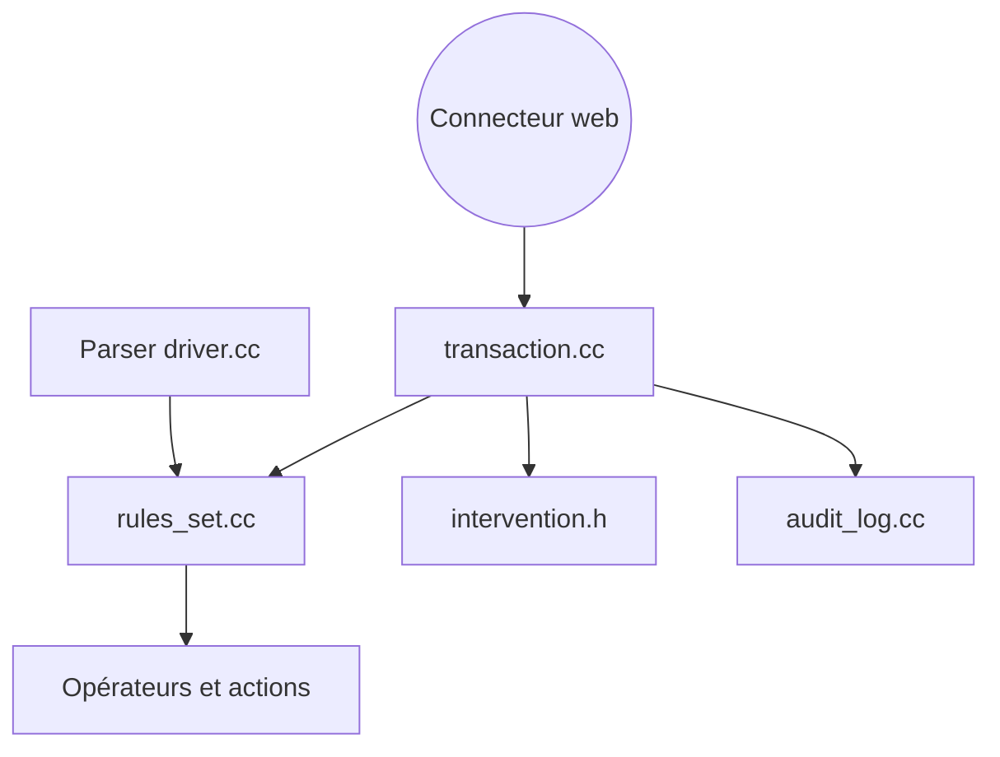

# owasp-modsecurity/ModSecurity

> Bibliothèque C++ de pare-feu applicatif web, appliquant des règles SecRules via des connecteurs serveur.

## Le problème
Filtrer le trafic HTTP malveillant demande un moteur de règles indépendant du serveur web.

## Ce que ça fait vraiment
libmodsecurity charge des règles au format SecRules et les applique par phases aux requêtes et réponses fournies par un connecteur (Nginx par exemple, dépôt séparé). Elle renvoie une décision d'intervention, tient des collections persistantes et écrit journaux d'audit et de debug. Réécriture de ModSecurity v2 sans dépendance à Apache.

## Comment c'est branché


## Essayer
```bash
git submodule update --init --recursive
./build.sh
./configure
make
sudo make install
```

## Coût et pièges
Gratuit. Compilation avec sous-modules obligatoires (libinjection, mbedtls), C++17, Flex/Bison, YAJL. Sans ensemble de règles, la protection est minimale.

## Ce que ce n'est pas
Pas un produit prêt à l'emploi : sans connecteur ni règles (OWASP CRS), il ne filtre rien. Ce n'est plus le module Apache v2.

## Alternatives
Aucune alternative nommée dans le README.

## Pour toi
À surveiller : utile seulement si tu exposes toi-même une API ou un modèle derrière Nginx et veux un filtrage de base.

