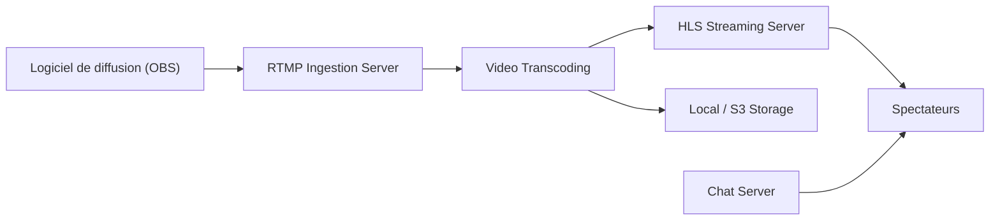

# owncast/owncast

> A self-hosted live video streaming server with chat, for a single broadcaster.

## The problem
Streaming live on a mainstream platform means losing control over the content, the interface and the moderation.

## What it actually does
A single service receives the RTMP stream from OBS or similar, transcodes it (ffmpeg) and serves it as HLS with a WebSocket chat. According to the described architecture: ActivityPub federation, webhooks, metrics, local or S3-compatible storage, SQLite database.

## How it is wired


## Trying it
```bash
git clone https://github.com/owncast/owncast
go run main.go
cd web && npm install && npm run dev
```

## Cost and gotchas
Free, but building requires a C compiler, ffmpeg and Go 1.24. Windows is not natively supported (WSL2 possible). The `develop` branch is not the stable version.

## What it is not
Not multi-broadcaster: "single user". Not a hosting service: bandwidth is on you.

## Alternatives
No alternative named in the README.

## For you
Ignore: self-hosted video streaming, outside the data/AI/MLOps scope.
