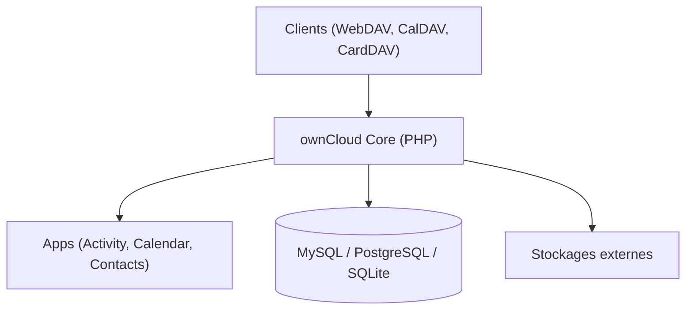

# owncloud/core

> PHP server for file storage, synchronization and sharing, the base of ownCloud Classic.

## The problem
Self-hosting your files, calendars and contacts without depending on a public cloud.

## What it actually does
WebDAV, CalDAV and CardDAV server with a plugin architecture, user and group management, encryption, external storage and a REST API. Databases: MySQL, MariaDB, PostgreSQL or SQLite. Docker image available. Owned by Kiteworks since 2023.

## How it is wired

Diagram inferred from the README; no diagram provided.

## Trying it
```bash
make
```
Development prerequisites: Composer v2, Yarn, Node 14+. Server installation: see the official manual.

## Cost and gotchas
Contributions: GPG-signed commits and DCO are mandatory. For production, the README points to the installation manual.

## What it is not
Not the new generation: that one is ownCloud Infinite Scale (oCIS).

## Alternatives
- ownCloud Infinite Scale (oCIS): next-generation platform cited by the README.

## For you
Ignore: generic file storage, unrelated to data/AI work, unless you need self-hosted sharing.
