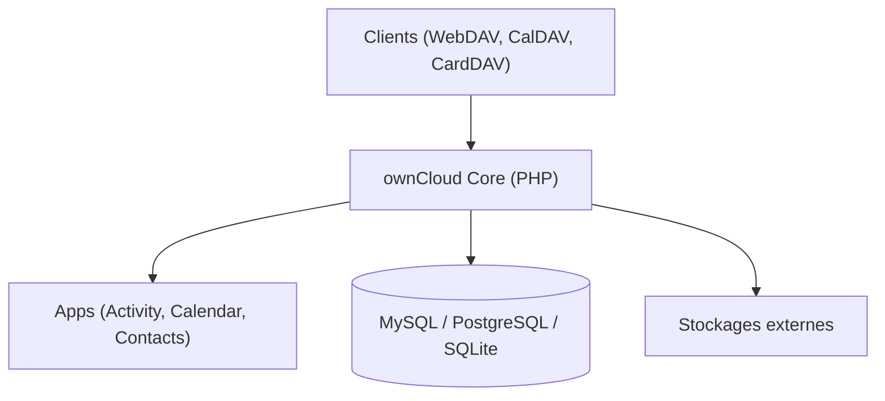

# owncloud/core

> Serveur PHP de stockage, synchronisation et partage de fichiers, base d'ownCloud Classic.

## Le problème
Héberger soi-même ses fichiers, agendas et contacts sans dépendre d'un cloud public.

## Ce que ça fait vraiment
Serveur WebDAV, CalDAV et CardDAV avec architecture de plugins, gestion d'utilisateurs et de groupes, chiffrement, stockages externes et API REST. Bases MySQL, MariaDB, PostgreSQL ou SQLite. Image Docker disponible. Propriété de Kiteworks depuis 2023.

## Comment c'est branché

Schéma déduit du README ; aucun diagramme fourni.

## Essayer
```bash
make
```
Prérequis de développement : Composer v2, Yarn, Node 14+. Installation serveur : voir le manuel officiel.

## Coût et pièges
Contributions : commits signés GPG et DCO obligatoires. Pour la production, le README renvoie au manuel d'installation.

## Ce que ce n'est pas
Pas la nouvelle génération : celle-ci est ownCloud Infinite Scale (oCIS).

## Alternatives
- ownCloud Infinite Scale (oCIS) : plateforme de nouvelle génération citée par le README.

## Pour toi
Ignorer : stockage de fichiers générique, sans lien avec le travail data/IA, sauf besoin d'un partage auto-hébergé.

