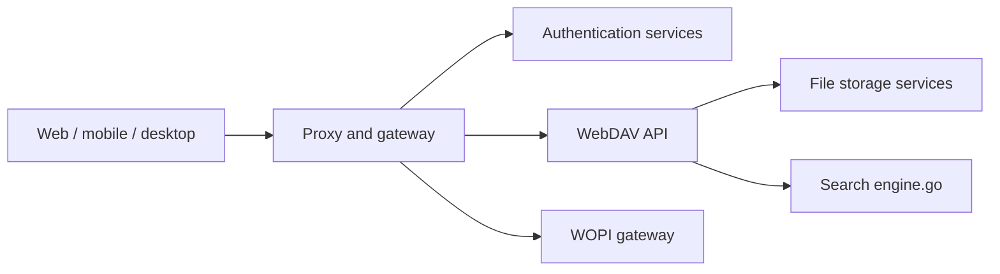

# owncloud/ocis

> ownCloud file sharing and synchronization platform as a single binary or container, for administrators.

## The problem
Self-hosting shared file storage, with identity and collaborative editing, without assembling ten services.

## What it actually does
A multi-service binary or container (from Raspberry Pi to Kubernetes) based on reva, with WebDAV and LibreGraph APIs, built-in web client, Android/iOS/desktop clients, OIDC authentication (Keycloak or embedded IdP), sharing, search, notifications, a policy engine and a WOPI gateway for Collabora, OnlyOffice or Office Online.

## How it is wired


## Trying it
```bash
docker pull owncloud/ocis
docker run --rm -it --mount type=bind,source=$HOME/ocis/ocis-config,target=/etc/ocis \
  --mount type=bind,source=$HOME/ocis/ocis-data,target=/var/lib/ocis \
  owncloud/ocis init --insecure yes
```
(then start with `docker run … owncloud/ocis`, see the README)

## Cost and gotchas
Free; production requires reading the prerequisites and a serious configuration. Source build: Go 1.25.10 and a C compiler. 619 open issues.

## What it is not
Not a data/AI tool: a file cloud. The web client has been brought back into this repository.

## Alternatives
No alternative named in the README.

## For you
Ignore for a data/AI profile: unless you need self-hosted shared storage, it falls outside your scope.
