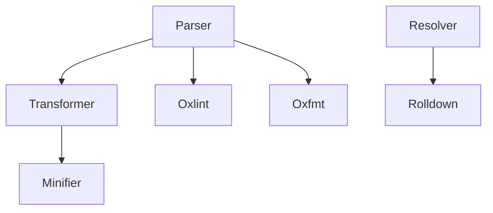

# oxc-project/oxc

> JavaScript/TypeScript toolkit in Rust: parser, linter, formatter, minifier, resolver, for front-end developers.

## The problem
JS toolchains written in JS (lint, format, build) are slow on large repositories.

## What it actually does
Provides a parser, a transformer (TS, JSX), a minifier and a module resolver, plus Oxlint and Oxfmt on the command line. Serves as the foundation for Rolldown and for Nuxt's parsing; Preact, Shopify and ByteDance use oxlint.

## How it is wired


## Trying it
```bash
npx oxlint@latest
npx oxfmt@latest
```

## Cost and gotchas
Free. ESLint rule coverage is partial according to the README (not detailed here).

## What it is not
Not a Python/data tool. Not a standalone bundler: Rolldown is a neighboring project.

## Alternatives
No alternative named in the README.

## For you
Watch: useful only if you have JS/TS (dashboards, AI apps) to lint quickly; outside the data core business.
