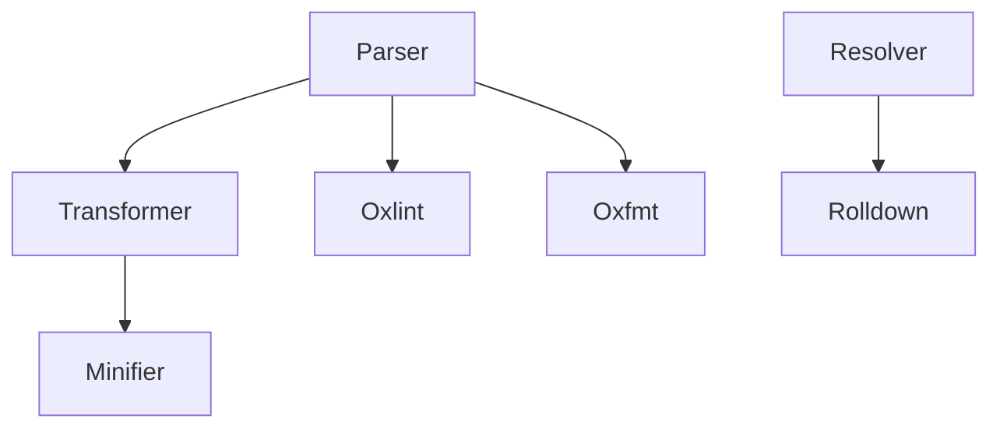

# oxc-project/oxc

> Boîte à outils JavaScript/TypeScript en Rust : parseur, linter, formateur, minifieur, résolveur, pour développeurs front.

## Le problème
Les chaînes d'outils JS en JS (lint, format, build) sont lentes sur de gros dépôts.

## Ce que ça fait vraiment
Fournit un parseur, un transformeur (TS, JSX), un minifieur et un résolveur de modules, plus Oxlint et Oxfmt en ligne de commande. Sert de base à Rolldown et au parsing de Nuxt ; Preact, Shopify, ByteDance utilisent oxlint.

## Comment c'est branché


## Essayer
```bash
npx oxlint@latest
npx oxfmt@latest
```

## Coût et pièges
Gratuit. Couverture des règles ESLint partielle selon le README (non détaillé ici).

## Ce que ce n'est pas
Pas un outil Python/data. Pas un bundler seul : Rolldown est un projet voisin.

## Alternatives
Aucune alternative nommée dans le README.

## Pour toi
Surveiller : utile seulement si tu as du JS/TS (dashboards, apps IA) à linter vite ; hors cœur de métier data.

