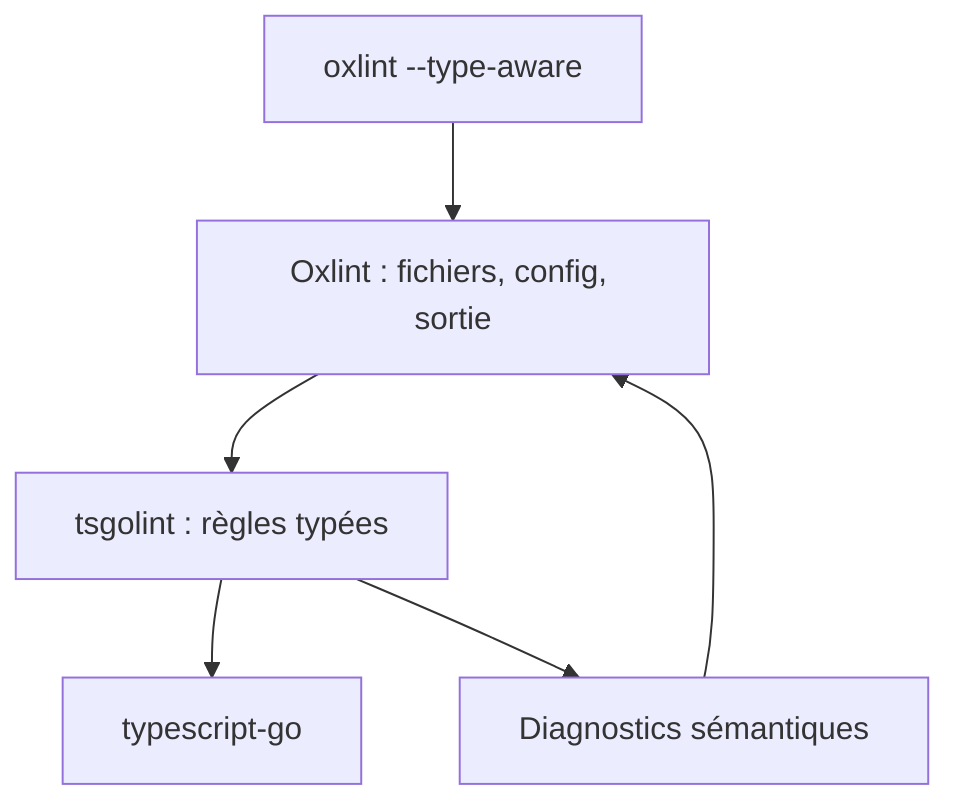

# oxc-project/tsgolint

> Typed lint rule engine for Oxlint, built on typescript-go, for TypeScript projects.

## The problem
Classic typed linting (ESLint + typescript-eslint) embeds the TypeScript compiler inside a JavaScript linter: slow startup, AST conversions, little parallelism, high memory use on large repositories.

## What it actually does
- Runs the `typescript/*` rules that require semantic analysis, directly on typescript-go (TypeScript 7).
- 59 of the 61 targeted typescript-eslint rules are implemented (`naming-convention` and `prefer-destructuring` are missing).
- Oxlint handles files, config and output; tsgolint emits the semantic diagnostics, in parallel across multiple cores.
- README benchmarks (Apple M4 Pro): 12x to 18x faster than ESLint + typescript-eslint.

## How it is wired


## Trying it
```bash
pnpm dlx oxlint --type-aware
oxlint --type-aware
oxlint --type-aware --type-check
```

## Cost and gotchas
Free, MIT. Versions follow those of TypeScript 7 (e.g. `v7.0.2001`). Config lives in `.oxlintrc.json` (`typeAware`, `typeCheck`).

## What it is not
Not a standalone linter: it is used through Oxlint. PRs for new rules outside typescript-eslint are not accepted. The speed figures come from the authors.

## Alternatives
- ESLint + typescript-eslint: a wider rule ecosystem, but slower according to the benchmarks.

## For you
Worth adopting if you have TypeScript in CI: the announced time saving is large and the project is active (last push 2026-10-19).
