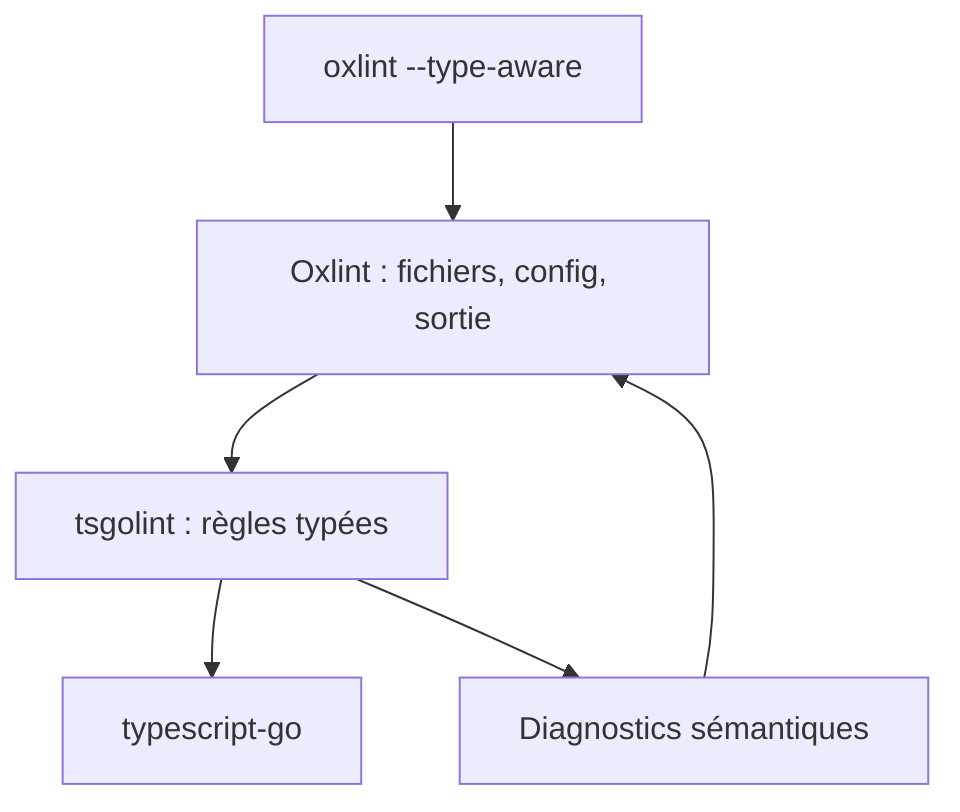

# oxc-project/tsgolint

> Moteur de règles de lint typées pour Oxlint, bâti sur typescript-go, pour les projets TypeScript.

## Le problème
Le lint typé classique (ESLint + typescript-eslint) embarque le compilateur TypeScript dans un linter JavaScript : démarrage lent, conversions d'AST, peu de parallélisme, mémoire élevée sur les gros dépôts.

## Ce que ça fait vraiment
- Exécute les règles `typescript/*` qui exigent l'analyse sémantique, directement sur typescript-go (TypeScript 7).
- 59 des 61 règles ciblées de typescript-eslint sont implémentées (manquent `naming-convention` et `prefer-destructuring`).
- Oxlint gère fichiers, config et sortie ; tsgolint émet les diagnostics sémantiques, en parallèle multi-cœurs.
- Benchmarks du README (Apple M4 Pro) : de 12x à 18x plus rapide qu'ESLint + typescript-eslint.

## Comment c'est branché


## Essayer
```bash
pnpm dlx oxlint --type-aware
oxlint --type-aware
oxlint --type-aware --type-check
```

## Coût et pièges
Gratuit, MIT. Les versions suivent celles de TypeScript 7 (ex. `v7.0.2001`). Config dans `.oxlintrc.json` (`typeAware`, `typeCheck`).

## Ce que ce n'est pas
Pas un linter autonome : il s'utilise via Oxlint. Les PR pour de nouvelles règles hors typescript-eslint ne sont pas acceptées. Les chiffres de vitesse viennent des auteurs.

## Alternatives
- ESLint + typescript-eslint : écosystème de règles plus large, mais plus lent selon les benchmarks.

## Pour toi
À adopter si tu as du TypeScript en CI : le gain de temps annoncé est fort et le projet est actif (dernier push 2026-10-19).

