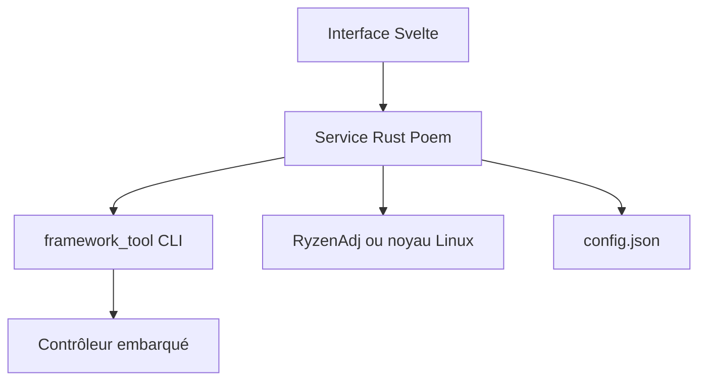

# ozturkkl/framework-control

> Local service with a web interface to tune fans, power and charge on Framework laptops.

## The problem
Framework computers offer no fine-grained control of fans, power and charging outside low-level tools.

## What it actually does
A Rust service, local and bound to the loopback (127.0.0.1), drives `framework_tool` for the embedded controllers. Svelte interface: fan curves with hysteresis, calibration, temperature and battery graphs, charge limit and power profiles (RyzenAdj on Windows, kernel interfaces on Linux).

## How it is wired


## Trying it
```bash
curl -fsSL https://raw.githubusercontent.com/ozturkkl/framework-control/main/install-linux.sh | sudo bash
yay -S framework-control
cd framework-control/service && cargo run
```

## Cost and gotchas
Framework hardware only; the Framework 16 requires BIOS 3.07 at minimum. Installation goes through `curl | sudo bash`. Settings are changed at your own risk, per the README warning.

## What it is not
Not a general-purpose thermal management tool: Framework machines only. No application signing on Windows for now.

## Alternatives
No alternative named in the README.

## For you
Ignore: a hardware utility for Framework laptops, unrelated to data or AI.
