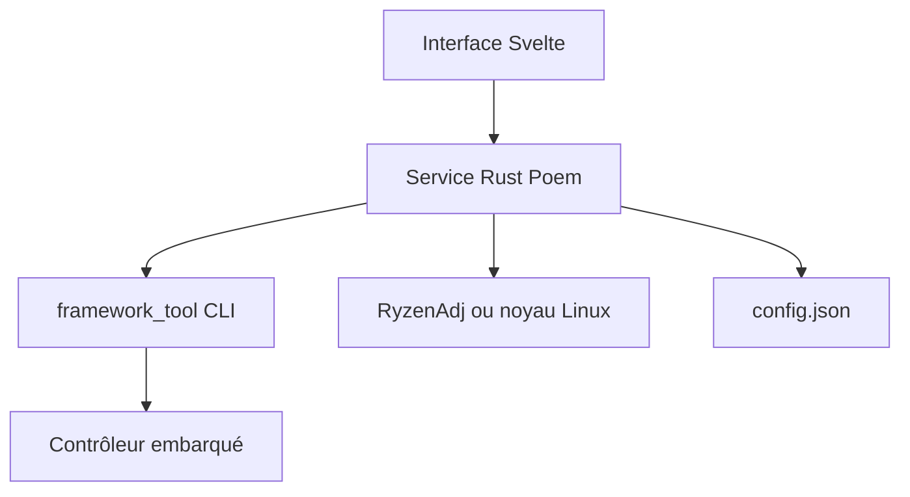

# ozturkkl/framework-control

> Service local avec interface web pour régler ventilateurs, puissance et charge des portables Framework.

## Le problème
Les ordinateurs Framework n'offrent pas, hors outils bas niveau, de réglage fin des ventilateurs, de la puissance et de la charge.

## Ce que ça fait vraiment
Un service Rust, local et lié à la boucle locale (127.0.0.1), commande `framework_tool` pour les contrôleurs embarqués. Interface Svelte : courbes de ventilateur avec hystérésis, étalonnage, graphes de température et de batterie, limite de charge et profils de puissance (RyzenAdj sous Windows, interfaces noyau sous Linux).

## Comment c'est branché


## Essayer
```bash
curl -fsSL https://raw.githubusercontent.com/ozturkkl/framework-control/main/install-linux.sh | sudo bash
yay -S framework-control
cd framework-control/service && cargo run
```

## Coût et pièges
Réservé au matériel Framework ; le Framework 16 demande un BIOS 3.07 au minimum. L'installation passe par `curl | sudo bash`. Les réglages se font à tes risques, selon l'avertissement du README.

## Ce que ce n'est pas
Pas un outil généraliste de gestion thermique : seulement les machines Framework. Pas de signature de l'application sous Windows pour l'instant.

## Alternatives
Aucune alternative nommée dans le README.

## Pour toi
Ignorer : utilitaire matériel pour portables Framework, sans rapport avec la data ou l'IA.

