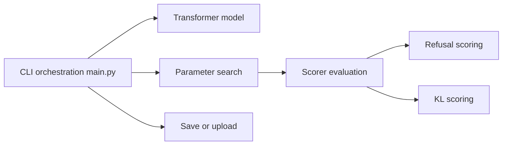

# p-e-w/heretic

> Command-line tool that automatically removes refusals from a language model, with analysis features for research.

## The problem
Aligned models sometimes refuse legitimate requests, and existing methods for removing refusals require manual tuning.

## What it actually does
It loads a transformer model and computes, per layer, a direction separating the responses to "harmful" and "harmless" prompts. It attenuates that direction in the model's matrices. An Optuna search picks the parameters to reduce refusals while limiting the gap from the original model (KL divergence). Then: saving, uploading to Hugging Face, a test chat or benchmarks. A research option produces projections of the residual vectors.

## How it is wired


## Trying it
```bash
pip install -U heretic-llm
heretic Qwen/Qwen3-4B-Instruct-2507
heretic --help
pip install -U 'heretic-llm[research]'
```

## Cost and gotchas
Free. A GPU is required: about 20 to 30 minutes on an RTX 3090 for a 4-billion-parameter model. `bnb_4bit` quantization reduces VRAM. The research feature's projections can take more than an hour on CPU.

## What it is not
It is not a neutral tool: it removes safety guardrails, so uses and distribution of the modified model are the user's responsibility, subject to the original model's terms and applicable law. The AGPL-3.0 license requires opening the code when used over a network.

## Alternatives
The README cites AutoAbliteration, abliterator.py, ErisForge and deccp as prior work, but says it reuses none of their code.

## For you
Keep an eye on it: interesting for interpretability and alignment evaluation on open models, provided you respect the models' licenses and the AGPL.
