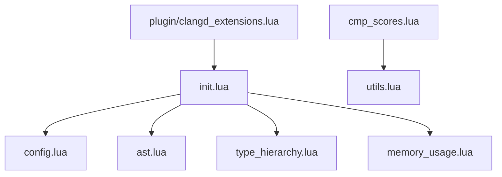

# p00f/clangd_extensions.nvim

> Neovim plugin that exposes the clangd protocol extensions: AST, type hierarchy, memory.

## The problem
Neovim does not natively implement the extensions specific to clangd.

## What it actually does
`plugin/clangd_extensions.lua` loads `init.lua`, which reads the config and exposes one command per extension: `:ClangdAST`, `:ClangdSymbolInfo`, `:ClangdTypeHierarchy`, `:ClangdMemoryUsage`, `:ClangdSwitchSourceHeader`. A score comparator for nvim-cmp completes the set. One extension (forcing diagnostics) is still not done.

## How it is wired


## Trying it
```lua
require("clangd_extensions").setup({})
-- puis :ClangdAST, :ClangdSymbolInfo, :ClangdMemoryUsage
```

## Cost and gotchas
Free. Neovim 0.10 minimum; clangd must already be configured via lspconfig. Same repository as dchinmay2/clangd_extensions.nvim (same stars and date).

## What it is not
It is not an LSP client nor a clangd installer.

## Alternatives
No alternative named in the README.

## For you
Ignore: useful for C and C++ under Neovim, unrelated to everyday data / AI work.
