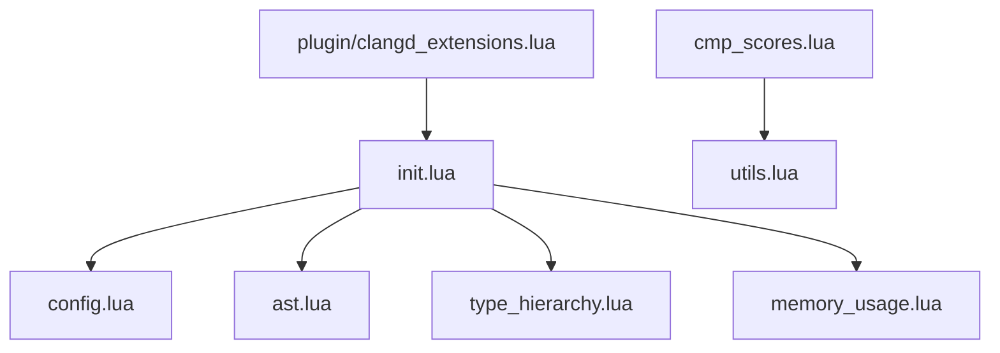

# p00f/clangd_extensions.nvim

> Plugin Neovim qui expose les extensions du protocole clangd : AST, hiérarchie de types, mémoire.

## Le problème
Neovim n'implémente pas nativement les extensions propres à clangd.

## Ce que ça fait vraiment
`plugin/clangd_extensions.lua` charge `init.lua`, qui lit la config et expose une commande par extension : `:ClangdAST`, `:ClangdSymbolInfo`, `:ClangdTypeHierarchy`, `:ClangdMemoryUsage`, `:ClangdSwitchSourceHeader`. Un comparateur de scores pour nvim-cmp complète l'ensemble. Une extension (forcer les diagnostics) reste non faite.

## Comment c'est branché


## Essayer
```lua
require("clangd_extensions").setup({})
-- puis :ClangdAST, :ClangdSymbolInfo, :ClangdMemoryUsage
```

## Coût et pièges
Gratuit. Neovim 0.10 minimum ; clangd doit déjà être configuré via lspconfig. Même dépôt que dchinmay2/clangd_extensions.nvim (mêmes étoiles et date).

## Ce que ce n'est pas
Ce n'est pas un client LSP ni un installeur de clangd.

## Alternatives
Aucune alternative nommée dans le README.

## Pour toi
À ignorer : utile pour le C et C++ sous Neovim, sans rapport avec un travail data / IA courant.

